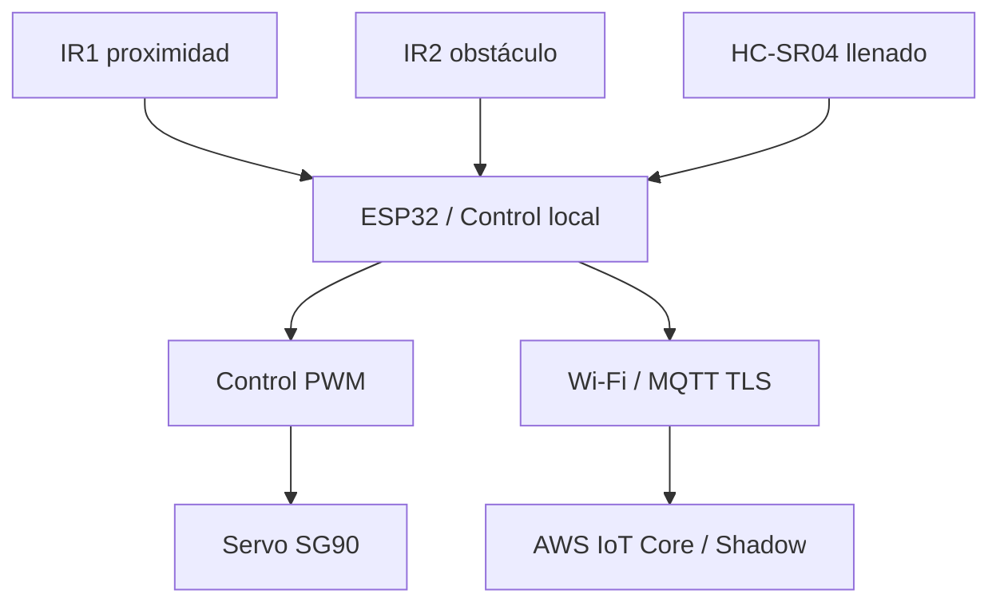
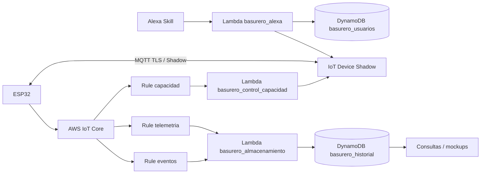
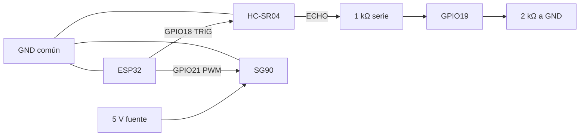
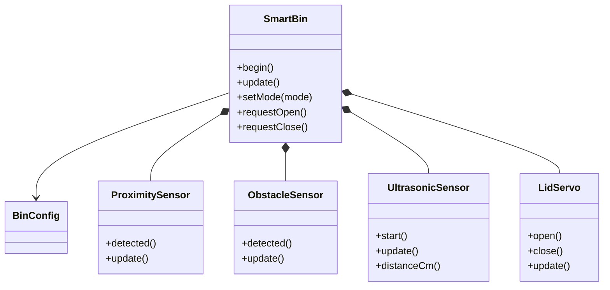
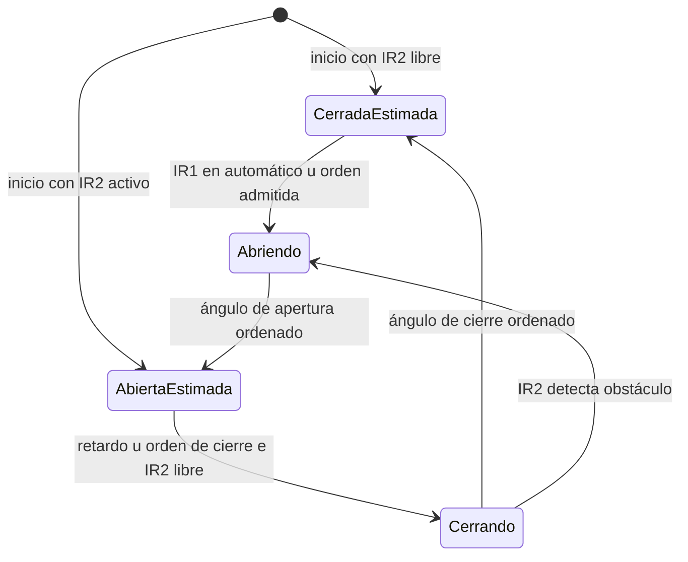
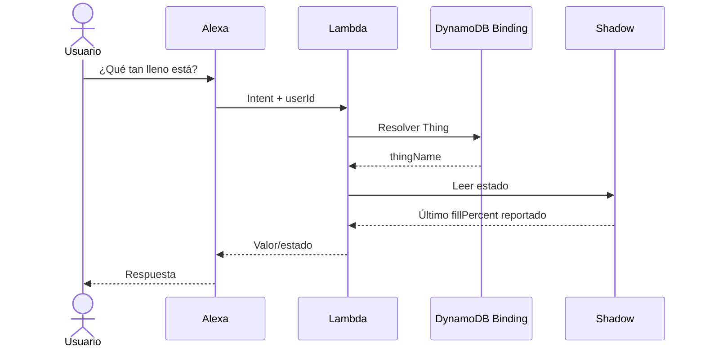
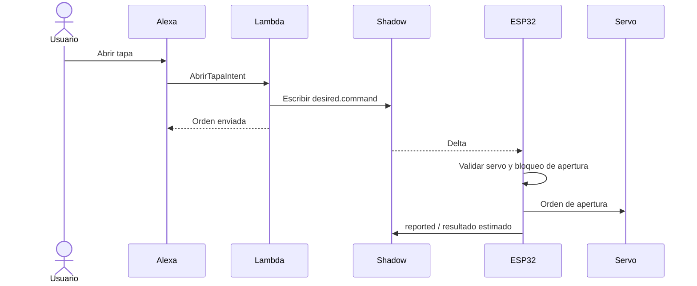
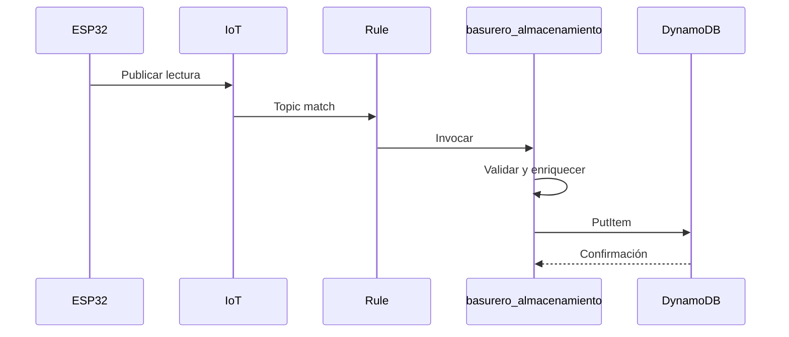
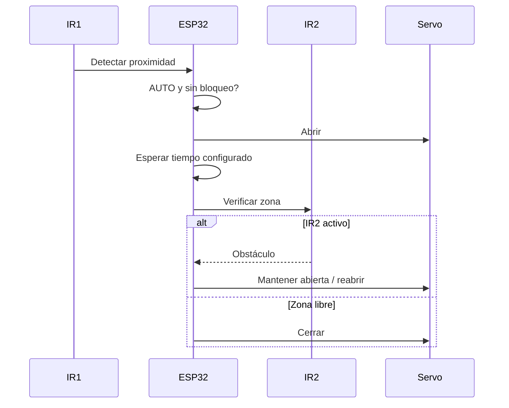
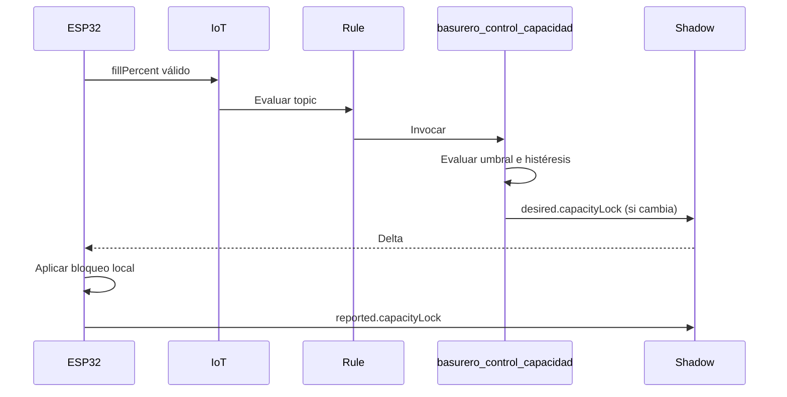

# Práctica 4 — Basurero Inteligente con AWS IoT y Alexa

**Proyecto:** Basurero inteligente  
**Plataforma:** ESP32 / PlatformIO  
**Asignatura:** SIS-234 – IoT  
**Integrantes:** Lucas Rodriguez , Josue Camacho , Pablo Raya  
**Docente:** Eduardo Marin  
**Fecha:** 24-11-26  
**Repositorio:** [Practica4_IoT_BasureroInteligente](https://github.com/Lucas-RodriguezAncieta/Practica4_IoT_BasureroInteligente)

> **Estado:** documento de diseño y validación. El repositorio incluye código y capturas de AWS en [docs/aws](docs/aws/README.md); queda por confirmar que los archivos correspondan exactamente a las versiones desplegadas y completar las pruebas cuantitativas con sus evidencias.

## 1. Caso de uso y requerimientos

### 1.1. Descripción

El basurero inteligente automatiza la apertura y cierre de la tapa, detecta obstáculos en la zona de cierre y mide el nivel de llenado. El ESP32 realiza el control local para mantener las funciones principales sin Internet. AWS IoT Core y Device Shadow sincronizan datos y comandos; Lambda procesa telemetría y lógica de capacidad; DynamoDB conserva lecturas y eventos; Alexa permite consultar y controlar el dispositivo por voz.

### 1.2. Objetivo

Implementar un basurero inteligente que combine control local, medición de llenado, comunicación segura con AWS, almacenamiento histórico y control por Alexa.

### 1.3. Componentes y justificación

| Componente | Función |
|---|---|
| ESP32 DevKit | Control de sensores, servo y conectividad Wi-Fi. |
| IR1 | Detecta proximidad frontal y solicita apertura en modo AUTO. |
| IR2 | Detecta obstáculos en la zona supervisada de cierre. |
| HC-SR04 | Mide distancia a los residuos para estimar llenado. |
| SG90 | Mueve la tapa; no ofrece confirmación física de posición. |
| AWS IoT Core / Shadow | Comunicación MQTT segura y sincronización de estados/órdenes. |
| AWS IoT Rules | Enruta telemetría y eventos a Lambdas. |
| AWS Lambda | Validación/almacenamiento, lógica de capacidad y backend de Alexa. |
| DynamoDB | Guarda histórico y vinculación usuario–Thing. |
| Alexa Skill | Consultas y comandos por voz. |

### 1.4. Requerimientos funcionales

> La siguiente tabla utiliza identificadores propios para resumir el alcance funcional. La consigna mantiene los RF1–RF9 de la Práctica 3 y añade RF10–RF15; falta cotejar los primeros con su enunciado original.

| ID | Requerimiento | Verificación |
|---|---|---|
| RF01 | Detectar proximidad | IR1 detecta y libera correctamente. |
| RF02 | Abrir/cerrar tapa | El servo ejecuta órdenes permitidas. |
| RF03 | Proteger el cierre | IR2 impide o interrumpe el cierre ante obstáculo. |
| RF04 | Cierre temporizado | Cierra tras el tiempo configurado, si IR2 está libre. |
| RF05 | Medir llenado | Calcula porcentaje calibrado entre 0 y 100 %. |
| RF06 | Publicar telemetría y eventos | Los mensajes incluyen dispositivo, tiempo y datos relevantes. |
| RF07 | Consultar estado por Alexa | Consulta llenado, tapa, modo y parámetros. |
| RF08 | Control por Alexa | Comandos se validan y envían mediante Shadow. |
| RF09 | Operación offline | Funciones esenciales siguen en Edge y se recupera conexión. |
| RF10 | Procesar datos en AWS | IoT Rules activan Lambda para validar y enrutar. |
| RF11 | Guardar lecturas | Lambda almacena mediciones válidas en DynamoDB. |
| RF12 | Guardar eventos | Se registran cambios/órdenes y origen cuando está disponible. |
| RF13 | Lógica de capacidad | Cloud actualiza bloqueo en Shadow y Edge lo aplica. |
| RF14 | Sincronizar parámetros | Shadow conserva modo y parámetros en reported; comandos llegan por desired. |
| RF15 | Diseñar reportes | Mockups basados en datos de DynamoDB para apoyar decisiones. |

### 1.5. Requerimientos no funcionales

| ID | Requerimiento | Métrica / criterio propuesto |
|---|---|---|
| RNF01 | Integridad de datos | Almacenar ≥99 % de mensajes válidos durante la prueba. |
| RNF02 | Latencia almacenamiento | Objetivo ≤5 s; registrar mediana, P95 y máximo si es posible. |
| RNF03 | Respuesta Edge | IR1 a inicio de movimiento: objetivo ≤500 ms. |
| RNF04 | Respuesta Cloud | Comando a inicio de movimiento: objetivo ≤5 s bajo red estable. |
| RNF05 | Offline | Control local funciona sin Internet; registrar pérdidas y recuperación. |
| RNF06 | Seguridad eléctrica | GPIO de ESP32 no recibe más de 3,3 V; fuente adecuada para servo y GND común. |
| RNF07 | Seguridad cloud | TLS/certificados, permisos limitados y secretos fuera del repositorio. |
| RNF08 | Modularidad | Código organizado, build reproducible y configuración centralizada. |
| RNF09 | Recuperación | Registrar tiempo de reconexión y sincronización de Shadow. |
| RNF10 | Costos | Estimar IoT, Lambda, DynamoDB y logs según uso mensual. |

## 2. Análisis y diseño

### 2.1. Control del objeto (Edge)

El ESP32 controla sensores, servo y máquina de estados. IR1 solicita apertura en modo automático; IR2 tiene prioridad para impedir el cierre cuando detecta un obstáculo. El HC-SR04 mide el llenado cuando la tapa está en condición estable. El servo se mueve entre posiciones configuradas, pendientes de verificar con el mecanismo. Como el SG90 no tiene realimentación, el estado de tapa debe indicarse como **estimado**, no como posición físicamente confirmada.

### 2.2. Diagrama de bloques



### 2.3. Arquitectura AWS



Alexa y Lambda no controlan GPIO directamente. Los comandos se escriben en `desired`; el ESP32 recibe el delta, valida condiciones, ejecuta localmente y actualiza `reported` con el estado estimado/aplicado.

### 2.4. Conexiones eléctricas

El firmware configura la señal del servo en GPIO21. El cableado físico y los valores del divisor deben contrastarse con el montaje real.

| Módulo | ESP32 | Nota |
|---|---|---|
| IR1 OUT | GPIO27 | Verificar nivel lógico/polaridad (máximo 3,3 V). |
| IR2 OUT | GPIO26 | Verificar nivel lógico/polaridad (máximo 3,3 V). |
| HC-SR04 TRIG | GPIO18 | Salida digital. |
| HC-SR04 ECHO | GPIO19 con divisor resistivo | Reducir señal de 5 V a nivel seguro; no conectar directo. |
| SG90 señal | GPIO21 | PWM; servo con fuente de 5 V apropiada. |
| Alimentación | 5 V y GND común | Verificar corriente del servo y evitar reinicios. |

Divisor ECHO propuesto, no confirmado como montaje real: ECHO → 1 kΩ → GPIO19; GPIO19 → 2 kΩ → GND. Con entrada de 5 V ideal proporciona aproximadamente 3,33 V; confirmar valores reales, tolerancias y tensión con multímetro.



### 2.5. Módulos y clases

Las clases del firmware se encuentran en [include](include/) y [src](src/).

| Módulo/clase | Responsabilidad |
|---|---|
| `BinConfig` | Pines, tiempos, ángulos, calibración y umbrales. |
| `SmartBin` | Coordina sensores, modos, estados y acciones. |
| `ProximitySensor` / `ObstacleSensor` | Leen IR1 e IR2; filtran respectivamente la detección y la liberación. |
| UltrasonicSensor | Mide distancia, valida muestras y calcula nivel. |
| `LidServo` | Controla recorrido gradual y estado estimado de tapa. |
| `WiFiManager`, `AWSIoTManager`, `ShadowManager` | Gestionan conexión WiFi, MQTT/TLS y sincronización del Shadow. |
| Máquina de estados | Gestiona abrir, espera, cerrar y protección IR2. |
| Lambdas | Separan almacenamiento, lógica de capacidad y backend Alexa. |



### 2.6. Máquina de estados y prioridades



IR2 tiene prioridad sobre el cierre, incluidos los cierres solicitados por voz o en modo manual. MANUAL desactiva la apertura por IR1 y el cierre temporizado, pero mantiene la protección IR2. Si `capacityLock` está activo, el firmware rechaza nuevas solicitudes de apertura, incluidas las manuales, cuando el llenado alcanza el umbral o no hay medición válida. La reapertura de seguridad ante IR2 durante un cierre se ordena directamente.

### 2.7. Calibración de llenado

Calibrar en el recipiente real:
- `D_vacio`: distancia del sensor al fondo con recipiente vacío.
- `D_limite`: distancia al nivel máximo permitido.
- `D_actual`: lectura válida.

```math
Llenado(%) = ((D_vacio - D_actual) / (D_vacio - D_limite)) * 100
```

Limitar el resultado a 0–100 %. Los valores configurados (`EMPTY_CM=30`, `FULL_CM=5`) son provisionales hasta medirlos. El firmware realiza cinco intentos, descarta muestras inválidas y calcula la mediana con al menos tres válidas.

### 2.8. Device Shadow

Esquema correspondiente al firmware disponible:

| Atributo | Tipo | Uso / validación |
|---|---|---|
| `mode` | String | `AUTOMATICO` o `MANUAL`. |
| `autoCloseSeconds` | Integer | Tiempo de cierre entre 1 y 3600 segundos. |
| `fillAlertThreshold` | Integer | Umbral entre 1 y 100 % en firmware; la versión de Lambda Alexa revisada acepta 11–100. |
| `capacityLock` | Boolean | Bloqueo automático por capacidad. |
| `fillPercent` | Number | 0–100; al enviar null por lectura inválida AWS elimina el atributo de reported. |
| `distanceCm` | Number | Distancia válida; al enviar null AWS elimina el atributo de reported. |
| `lidState` | String | `abierta`, `cerrada`, `abriendo`, `cerrando` o `no_disponible`; posición estimada. |
| `irFrontDetected`, `irObstacleDetected` | Boolean | Estados de sensores. |
| `command` | Object | Orden transitoria en desired: `id`, `action` y `origin`. |

`desired` contiene parámetros/comandos solicitados; `reported` contiene los valores aplicados y estados reportados. El ESP32 valida los comandos, evita duplicados y mantiene prioridad de IR2. Sin realimentación, el estado de servo no confirma posición física.

El identificador de comando debe ser un entero positivo creciente por Thing. El ESP32 guarda en NVS el mayor ID antes de procesar la orden y solicita borrar `desired.command` mediante una actualización condicional por versión. Esto evita repetir IDs antiguos, pero ofrece ejecución como máximo una vez: un reinicio entre guardar el ID y procesar la orden puede perderla. Confirmar el borrado no demuestra que la tapa se haya movido.

### 2.9. Tópicos MQTT

| Tópico | Dirección | Propósito |
|---|---|---|
| `$aws/things/{THING}/shadow/get` | ESP32 → AWS | Solicitar estado Shadow. |
| `$aws/things/{THING}/shadow/get/accepted`, `$aws/things/{THING}/shadow/get/rejected` | AWS → ESP32 | Respuesta o error de la consulta inicial. |
| `$aws/things/{THING}/shadow/update` | Dispositivo/backend → AWS | Actualizar `desired`/`reported`. |
| `$aws/things/{THING}/shadow/update/delta` | AWS → ESP32 | Recibir cambios pendientes. |
| `$aws/things/{THING}/shadow/update/accepted` | AWS → clientes | Confirmación de actualización. |
| `$aws/things/{THING}/shadow/update/rejected` | AWS → clientes | Error de actualización. |
| `basurero/{THING}/telemetria` | ESP32 → AWS | Lecturas y estado periódico. |
| `basurero/{THING}/eventos` | ESP32 → AWS | Aperturas, cierres, órdenes y alertas. |

El firmware documenta una cola RAM de 16 eventos y QoS 0; por ello la entrega de eventos no es garantizada y puede haber pérdidas durante desconexiones o saturación.

### 2.10. Modelo DynamoDB

**`basurero_usuarios`**
| Atributo | Tipo | Clave/uso |
|---|---|---|
| `userId` | String | Partition Key del usuario. |
| `thingName` | String | Thing vinculado. |
| `commandSeq` | Number | Contador en filas especiales `#seq#<thingName>`. |

**`basurero_historial`**
| Atributo | Tipo | Clave/uso |
|---|---|---|
| `thingName` | String | Partition Key. |
| `timestampId` | String | Sort Key: la Lambda incluida construye una fecha UTC ISO 8601 con milisegundos, tipo de registro y huella. Confirmar que corresponde a la versión desplegada. |
| `recordType` | String | TELEMETRIA o EVENTO según las reglas documentadas. |
| `fillPercent`, `distanceCm` | Number | Medición, si válida. |
| `lidState`, `mode` | String | Estado estimado y modo cuando estén disponibles. |
| `event`, `origin`, `detail` | String | Campos enviados por el firmware en eventos; contrastar el elemento persistido. |
| `commandId` | String opcional | Identificador de orden enviado en algunos eventos. |
| `receivedAt` | Number | Timestamp en milisegundos agregado por la regla; confirmar su conservación en DynamoDB. |

**Consultas previstas:** histórico por Thing y rango de tiempo, eventos y conteos por origen. En el código incluido la SK comienza con la fecha UTC, lo que permite diseñar rangos cronológicos usando los límites adecuados. La [documentación de DynamoDB](docs/aws/05-dynamodb.md) indica que no se configuró un índice secundario en las pruebas descritas y deja TTL como mejora. El último estado disponible se consulta en el Shadow; no se ha demostrado que se registren alertas de capacidad como eventos.

### 2.11. IoT Rules y Lambda

SQL incluido en el repositorio y documentado en el registro de configuración; contrastar con las reglas desplegadas:

```sql
SELECT *, topic(2) AS thingName, 'TELEMETRIA' AS recordType,
       timestamp() AS receivedAt
FROM 'basurero/+/telemetria'
```
**Regla:** `basurero_regla_telemetria`. **Acción:** invocar `basurero_almacenamiento`. [Archivo SQL](docs/aws/config/reglas/telemetria.sql).

```sql
SELECT *, topic(2) AS thingName, 'EVENTO' AS recordType,
       timestamp() AS receivedAt
FROM 'basurero/+/eventos'
```
**Regla:** `basurero_regla_eventos`. **Acción:** invocar `basurero_almacenamiento`. [Archivo SQL](docs/aws/config/reglas/eventos.sql).

```sql
SELECT topic(2) AS thingName, fillPercent
FROM 'basurero/+/telemetria'
WHERE NOT isUndefined(fillPercent)
```
**Regla:** `basurero_regla_capacidad`. **Acción:** invocar `basurero_control_capacidad`. El filtro comprueba la presencia del campo; la validación de tipo y rango corresponde a la función. [Archivo SQL](docs/aws/config/reglas/capacidad.sql).

| Lambda | Función | Disparador / recursos |
|---|---|---|
| `basurero_almacenamiento` | Validar y guardar telemetría y eventos. | Reglas IoT; DynamoDB `basurero_historial`. [Código incluido](docs/aws/lambdas/basurero_almacenamiento.py); confirmar correspondencia con el despliegue. |
| `basurero_control_capacidad` | Evaluar llenado; con umbral 90 %, solicitar bloqueo ≥90 % y liberación ≤80 %. | Regla de capacidad; Shadow. [Código incluido](docs/aws/lambdas/basurero_control_capacidad.py). |
| `basurero_alexa` | Resolver usuario a Thing, consultar Shadow y escribir comandos y parámetros en `desired`. | Alexa Skill; tabla `basurero_usuarios`; Shadow. [Código incluido](docs/aws/lambdas/basurero_alexa.py). |

Lambda no controla GPIO. El ESP32 aplica cambios recibidos. Permisos IAM deben limitarse a recursos necesarios (por ejemplo, `PutItem` para writer y `UpdateThingShadow` para controlador), documentando permisos más amplios si fueran necesarios durante la práctica.

La versión de almacenamiento incluida valida `thingName`, `recordType` y `receivedAt`; para telemetría exige porcentaje 0–100, distancia 2–400 cm y estados permitidos. Para eventos valida `event`, `origin`, `detail` y, si existe, `commandId`. Calcula una huella y usa una escritura condicional sobre la clave generada; no debe asumirse que esto elimina toda duplicación posible si el contenido o la marca de recepción cambia. La Lambda de capacidad valida el porcentaje, prefiere el umbral reportado y limita el umbral inferior a cero; utiliza la versión del Shadow y reintenta una vez ante conflicto. La correspondencia de estas versiones locales con las desplegadas aún debe comprobarse.

### 2.12. Skill Alexa

**Nombre de invocación documentado:** “basurero inteligente”; idioma `es-MX`. El [modelo de interacción incluido](docs/aws/config/alexa/interaction-model.json) contiene intents, slots y frases; falta confirmar que coincida con el modelo actualmente desplegado. Las frases de la tabla son ejemplos.
| Intent | Slot | Ejemplo |
|---|---|---|
| `VincularBasureroIntent` | `codigo` | Vincula el basurero con el código indicado. |
| `DesvincularBasureroIntent` | — | Desvincula el basurero. |
| `ConsultarNivelIntent` | — | ¿Qué tan lleno está? |
| `ConsultarTapaIntent` | — | ¿La tapa está abierta? |
| `ConsultarModoIntent` | — | ¿Está en automático? |
| `AbrirTapaIntent` | — | Abre el basurero. |
| `CerrarTapaIntent` | — | Cierra la tapa. |
| `CambiarModoIntent` | `modo` | Activa modo automático o manual. |
| `CambiarUmbralIntent` | `porcentaje` | Configura el umbral de llenado. |
| `CambiarRetardoIntent` | `segundos` | Configura el tiempo de cierre. |
| `ConsultarUmbralIntent`, `ConsultarRetardoIntent` | — | Consulta el umbral o el tiempo de cierre. |
| `ConsultarSensoresIntent`, `ConsultarBloqueoIntent` | — | Consulta sensores o bloqueo. |
| Amazon intents | — | Ayuda, cancelar, detener. |

Flujo de comando: Alexa → Lambda → resolver usuario/Thing → actualizar Shadow y responder que la solicitud fue enviada. De forma posterior e independiente, el ESP32 recibe el delta, valida la solicitud y reporta el estado estimado. La respuesta no confirma la ejecución física.

### 2.13. Secuencias principales

**Consulta de sensor por Alexa**


**Comando de actuador por voz**


**Telemetría a almacenamiento**


**Regla automática Edge: tapa**


**Regla automática Cloud: capacidad**


### 2.14. Edge vs Cloud

| Función | Ubicación | Motivo |
|---|---|---|
| Sensores, servo, temporizador y protección IR2 | Edge | Respuesta inmediata y funcionamiento offline. |
| Medición y validación inicial | Edge | Evita depender de red para lectura. |
| Histórico, consultas y reportes | Cloud | Persistencia y análisis de datos. |
| Bloqueo por capacidad | Cloud decide; Edge aplica | Permite actualizar lógica remotamente, manteniendo respuesta local. |
| Alexa y vinculación | Cloud | Gestión de usuario, intents y Shadow. |

### 2.15. Mockups de reportes

Mockups de diseño, no dashboards implementados. Los ejemplos de valores deben sustituirse por datos reales.

**A. Estado actual:** nivel, tapa estimada, modo, umbral y fecha de última lectura. Fuente prevista: Shadow y último registro de `basurero_historial`; el formato temporal de la clave se describe en §2.10 y debe contrastarse con el despliegue.

| Dispositivo | Llenado | Tapa estimada | Modo | Última lectura |
|---|---:|---|---|---|
| basurero-grupoX-01 | Ejemplo 72 % | Cerrada | AUTOMATICO | Ejemplo 10:15 UTC |

**B. Histórico de llenado:** gráfica de `fillPercent` por hora/fecha, consulta por `thingName` y rango temporal.

| Hora (ejemplo) | Llenado |
|---|---:|
| 08:00 | 40 % |
| 09:00 | 48 % |
| 10:00 | 57 % |

**C. Eventos:** apertura, cierre y origen. Fuente prevista: `basurero_historial` por Thing y período; verificar los campos persistidos.
| Fecha/hora (ejemplo) | Evento | Origen |
|---|---|---|
| 10:02 | Apertura | Edge |
| 10:45 | Cierre | Voz |

**D. Resumen de actividad:** conteos de aperturas/cierres y comandos de voz, calculados sobre eventos históricos. La existencia de alertas de capacidad registradas no está confirmada. Todos los valores de mockup son ilustrativos. La clave del código incluido empieza con fecha UTC ordenable; las consultas deben ajustarse al formato realmente desplegado. Los filtros y agregaciones pueden requerir leer elementos adicionales.

### 2.16. Estimación de tráfico y costos

Con una publicación cada 30 s durante 30 días: `2.880 mensajes/día × 30 = 86.400 mensajes/mes` por Thing. Si se envían actualizaciones Shadow a la misma frecuencia, sumar aproximadamente otras 86.400 solicitudes, además de eventos, comandos y reintentos. Cada telemetría puede activar una invocación de almacenamiento y otra de capacidad, hasta aproximadamente 86.400 de cada tipo bajo operación continua; si cada telemetría se guarda, serían 86.400 escrituras lógicas más los eventos. Estos son volúmenes de diseño, no importes facturados. Falta calcular el costo con región, tarifas vigentes, tamaño de mensajes, respuestas Shadow, redondeos, lecturas, logs y condiciones de la cuenta, y compararlo con los límites aplicables.

## 3. Desarrollo e implementación

### 3.1. Estructura del repositorio

Estructura disponible en el repositorio:
```text
├── include/ (configuración y headers)
├── src/ (main y clases del basurero/sensores/servo)
├── test/ (plan de pruebas)
├── docs/aws/ (documentación, Lambdas, configuraciones de ejemplo y capturas)
├── Informe.md (este informe)
├── CONFIGURACION_AWS_ALEXA_BASURERO_INTELIGENTE_P4.md
├── aws-iot-policy.example.json
├── platformio.ini
└── .gitignore
```

### 3.2. Firmware y control

La configuración centraliza pines, polaridad IR, tiempos, posiciones del servo y distancias provisionales en [BinConfig.h](include/BinConfig.h). [SmartBin.cpp](src/SmartBin.cpp) coordina sensores, modos y prioridades; [LidServo.cpp](src/LidServo.cpp) implementa movimiento gradual; [UltrasonicSensor.cpp](src/UltrasonicSensor.cpp) valida muestras y calcula la mediana. El SG90 no confirma posición; el sistema reporta estado estimado. Las clases de red se encuentran en [WiFiManager.cpp](src/WiFiManager.cpp), [AWSIoTManager.cpp](src/AWSIoTManager.cpp) y [ShadowManager.cpp](src/ShadowManager.cpp); [main.cpp](src/main.cpp) conecta ambas partes mediante colas.

### 3.3. Comunicación y tolerancia a fallos

El firmware descrito utiliza Wi-Fi, MQTT TLS (puerto 8883), certificados X.509, Shadow clásico, PubSubClient y ArduinoJson. El control local debe continuar sin red. La cola de 16 eventos en RAM y QoS 0 no garantizan persistencia: documentar pérdidas y recuperación.

### 3.4. Configuración AWS y seguridad

| Recurso | Configuración/evidencia a documentar |
|---|---|
| IoT Thing | `basurero-grupo3-01` físico y `basurero-grupo3-02` simulado; el primero usa certificado X.509. |
| Política IoT | [Plantilla sin secretos](aws-iot-policy.example.json) con Connect, Publish, Subscribe y Receive sobre recursos del Thing. |
| IoT Rules | Tres reglas documentadas en §2.11, con acciones hacia almacenamiento o control de capacidad. |
| Lambda | Tres funciones descritas en §2.11; el registro indica Python 3.12 y región `us-east-2`. El código está en [docs/aws/lambdas](docs/aws/lambdas/); confirmar correspondencia con las versiones desplegadas. |
| DynamoDB | `basurero_usuarios` y `basurero_historial`; claves en §2.10. GSI y TTL no confirmados. |
| Alexa | Skill `Basurero Inteligente`, locale `es-MX`, backend Lambda y simulador. El [modelo de interacción](docs/aws/config/alexa/interaction-model.json) está incluido; comprobar versión desplegada. |
| IAM | El registro indica que el rol de capacidad se amplió para ambos Things; contrastar permisos efectivos exportados. |
| Secretos | `include/CloudSecrets.h` excluido por [.gitignore](.gitignore); se entrega [plantilla](include/CloudSecrets.example.h). |

Como mínimo, el certificado del ESP32 necesita autorización para conectar y usar sus tópicos; Alexa necesita acceso a la tabla de vínculos y a los Shadows autorizados; almacenamiento requiere `dynamodb:PutItem` sobre historial; capacidad necesita leer y actualizar los Shadows correspondientes. Las funciones requieren logs y los servicios que las disparan, permisos de invocación. Estos son permisos necesarios del diseño; el conjunto exacto realmente asignado aún debe comprobarse.

Las políticas IAM incluidas para [Alexa](docs/aws/config/iam/alexa.example.json), [almacenamiento](docs/aws/config/iam/almacenamiento.example.json) y [capacidad](docs/aws/config/iam/capacidad.example.json) son **ejemplos**, no una exportación verificada de las políticas efectivamente asignadas. El registro describe que el rol de capacidad se amplió a ambos Things y que Alexa tenía alcance sobre `basurero-*`; el detalle completo requiere cotejo con IAM.

### 3.5. Parámetros iniciales

| Parámetro | Valor de referencia | Estado |
|---|---:|---|
| IR1 / IR2 | GPIO27 / GPIO26 | Configurados en firmware. |
| TRIG / ECHO | GPIO18 / GPIO19 | Confirmar divisor ECHO. |
| Servo | GPIO21 | Configurado en firmware; contrastar con el cableado. |
| Ángulo cerrado / abierto | 0° / 90° | Calibrar. |
| Movimiento servo | 1° cada 20 ms | Configurado; no es una velocidad física medida. |
| Tiempo abierto | 5 s iniciales | Configurable; el cierre manual puede solicitarse antes. |
| Bloqueo / liberación | 90 % / 80 % | Demostración documentada con Thing simulado; umbral configurable. |
| Intervalo de medición | 30 s | Configurado entre ciclos cuando la tapa está cerrada. |
| Publicación telemetría | 30 s | Configurado en firmware. |
| Cola de eventos | 16 elementos RAM | Configurado en firmware. |
| Medición ultrasónica | 5 intentos, ≥3 válidos | Configurado en firmware. |

## 4. Pruebas y validaciones

El [plan de 20 pruebas](test/Pruebas.md) define procedimiento y resultado esperado; todas figuran actualmente como pendientes en ese archivo. El [registro AWS/Alexa](CONFIGURACION_AWS_ALEXA_BASURERO_INTELIGENTE_P4.md) describe demostraciones realizadas, resumidas en §5, pero no sustituye los registros formales y evidencias individuales. Para cada prueba deben registrarse fecha, responsable, versión, condiciones, resultado, métrica y evidencia.

### Evidencias mínimas

- Fotos del prototipo y montaje/circuito, GPIO y divisor ECHO.
- Build PlatformIO y logs del monitor serie.
- Videos de apertura, cierre, IR2 y ciclos mecánicos.
- Calibración y datos de medición de llenado.
- MQTT Test Client, Shadow `desired/reported`, Rule SQL/acciones y logs Lambda.
- Items y consultas DynamoDB (ocultar datos personales).
- Alexa Simulator para consultas y comandos.
- Offline, reconexión y métricas.
- `.gitignore`, políticas IoT/IAM sin certificados ni claves privadas.

## 5. Resultados

El [registro de configuración y demostraciones](CONFIGURACION_AWS_ALEXA_BASURERO_INTELIGENTE_P4.md#13-pruebas-funcionales-realizadas-y-estado-de-evidencia) describe las observaciones siguientes. No se adjuntan allí series completas de ensayos ni todas las capturas; por ello no se presentan como validaciones cuantitativas cerradas.

### 5.1. Estado de implementación

| Elemento | Estado | Evidencia |
|---|---|---|
| Firmware y compilación | Existe firmware en el repositorio; falta adjuntar salida de build y versión de entrega. | [Código](src/) |
| Sensores y servo | El registro describe lecturas, movimiento físico y funcionamiento de modos. | Registro AWS §12–13; ensayos T01–T09 sin resultados formales. |
| Wi-Fi, MQTT TLS y Shadow | Se documentan conexión MQTT, Shadow recibido y reported aceptado. | Registro AWS §12–13; falta medición controlada de estabilidad. |
| IoT Rules y Lambda | Se describe ejecución de reglas para Thing 02. | Registro AWS §11–13; [SQL y código incluidos](docs/aws/README.md), aún sin verificar contra despliegue. |
| DynamoDB histórico | El registro describe telemetrías simuladas de 95 %, 85 % y 80 %. Una captura muestra lecturas y eventos de apertura/cierre del Thing 01. | [Captura del historial](docs/aws/evidencias/dynamodb/02-historial.png); no demuestra integridad ni latencia. |
| Alexa y vinculación | Se documenta consulta y control del Thing físico y consulta de un segundo Thing con identidad simulada. | Registro AWS §11–13; [captura de vinculaciones](docs/aws/evidencias/multithing/01-vinculaciones.png). No prueba dos cuentas Alexa reales. |
| Lógica Edge/Cloud | En Thing 02 simulado se documentó bloqueo a 95 %, permanencia a 85 % y desbloqueo a 80 %. | Registro AWS §11.4; no demuestra actuación física de un segundo ESP32. |
| Mockups de reportes | Diseños ilustrativos en §2.15. | Requieren contrastar consultas y campos persistidos. |

### 5.2. Métricas

| Métrica | Objetivo | Resultado | Cumple |
|---|---|---|---|
| Apertura Edge | ≤500 ms | [Medir] | [Sí/No] |
| IR2 a reacción | Registrar | [Medir] | [Sí/No] |
| Comando Cloud | ≤5 s | [Medir] | [Sí/No] |
| Escritura DynamoDB | ≤5 s | [Medir] | [Sí/No] |
| Integridad de datos | ≥99 % | [Medir] | [Sí/No] |
| Error de llenado | ≤10 pp | [Medir] | [Sí/No] |
| Reconexión MQTT/Shadow | Registrar | [Medir] | [Sí/No] |
| Eventos perdidos offline | Cuantificar | [Medir] | [Informar] |
| Ciclos mecánicos | 20 ciclos | [Medir] | [Sí/No] |
| Costo mensual AWS | Estimación | [Calcular] | [Documentar] |

### 5.3. Análisis

La secuencia 95/85/80 documentada en el Thing simulado es coherente con la histéresis configurada de 90/80. La simulación deja el delta pendiente sin un segundo ESP32 que confirme el estado físico. El registro también describe una reconexión MQTT, pero no una prueba controlada de interrupción, duración y recuperación.

La [captura del Shadow físico](docs/aws/evidencias/iot-core/03-device-shadow.png) muestra un estado reportado con modo automático, tapa estimada cerrada, distancia y llenado; es una instantánea y no demuestra por sí sola la trayectoria física. La [captura de Alexa](docs/aws/evidencias/alexa/02-prueba-voz.png) muestra una respuesta equivocada sobre la tapa ante una pregunta por bloqueo: documenta el error anterior a la corrección, no una prueba de que se corrigió. El registro narrativo describe una respuesta correcta posterior; falta una captura de esa repetición.

La separación Edge/Cloud deja sensores, servo y protección de cierre cerca del actuador y permite modificar la política de capacidad en la nube. QoS 0 y una cola limitada en RAM no garantizan entrega de eventos durante desconexiones. Los cambios rápidos de IR2 mencionados en el registro justifican comprobar su estabilidad y cobertura. Todavía no hay datos suficientes para evaluar precisión, tiempos, integridad o costo frente a los objetivos.

## 6. Conclusiones

El proyecto combina control local y servicios cloud. La protección del cierre se ubica en el ESP32 para reducir la dependencia de la conectividad; AWS IoT Core y Shadow sincronizan parámetros y comandos, mientras Rules y Lambda procesan datos y DynamoDB conserva históricos.

La documentación de la demostración registra control físico por Alexa y una prueba de histéresis en un segundo Thing simulado. Estos resultados respaldan los flujos observados, pero no equivalen a una campaña de medición ni demuestran el comportamiento de dos dispositivos físicos. El estado de la tapa es estimado porque no existe un sensor de posición.

Con la evidencia disponible no puede concluirse que se cumplen los objetivos numéricos de integridad, latencia, precisión de llenado y recuperación. Deben completarse las pruebas y anexos antes de evaluar esos requisitos.

## 7. Recomendaciones

- Calibrar las distancias de vacío y lleno con el recipiente real, registrar lecturas de referencia y cuantificar el error.
- Revisar el montaje de IR2 y su cobertura, y considerar una protección mecánica y realimentación de posición para reducir los riesgos e incertidumbre del cierre.
- Evaluar almacenamiento y reenvío local si se requiere conservar eventos durante cortes de red.
- Usar códigos de vinculación temporales y limitar permisos IAM y de IoT para una implementación de producción.
- Considerar una función programada para detectar ausencia de telemetría: una regla que depende de mensajes no detecta por sí sola que dejaron de llegar.

## 8. Anexos y evidencias

### 8.1. Documentos y código

- [Consigna y rúbrica de la práctica](Práctica_4.md).
- [Plan de pruebas T01–T20](test/Pruebas.md).
- [Configuración AWS, Alexa y registro de demostraciones](CONFIGURACION_AWS_ALEXA_BASURERO_INTELIGENTE_P4.md).
- [Documentación AWS, código Lambda y configuraciones](docs/aws/README.md).
- [Captura del historial](docs/aws/evidencias/dynamodb/02-historial.png), [Shadow del Thing físico](docs/aws/evidencias/iot-core/03-device-shadow.png), [vinculaciones](docs/aws/evidencias/multithing/01-vinculaciones.png) y [respuesta incorrecta previa de Alexa](docs/aws/evidencias/alexa/02-prueba-voz.png).
- [Configuración de pines y parámetros](include/BinConfig.h), [código fuente](src/) y [dependencias](platformio.ini).
- [Plantilla de política IoT](aws-iot-policy.example.json) y [plantilla sin credenciales](include/CloudSecrets.example.h).

### 8.2. Evidencias y entregables pendientes

1. Fotografías del montaje y esquema eléctrico con los valores realmente utilizados para el divisor de ECHO.
2. Resultados de T01–T20 con fecha, responsable, versión, condiciones, valores individuales y enlaces a capturas, logs o videos.
3. Medición de integridad, latencia Edge y Cloud, precisión del llenado y comportamiento durante la desconexión; incluir muestras de telemetría y eventos almacenados en DynamoDB.
4. Cotejar las tres Lambdas, el modelo Alexa y los SQL incluidos con las versiones desplegadas; incorporar exportaciones sanitizadas de las políticas IAM efectivamente asignadas, acciones de las reglas y definición de tablas. Confirmar campos persistidos, GSI y TTL.
5. Cálculo monetario mensual con tarifas y límites vigentes de la cuenta. Registrar versión o commit final, verificar que el repositorio sea accesible y que no contenga secretos.

