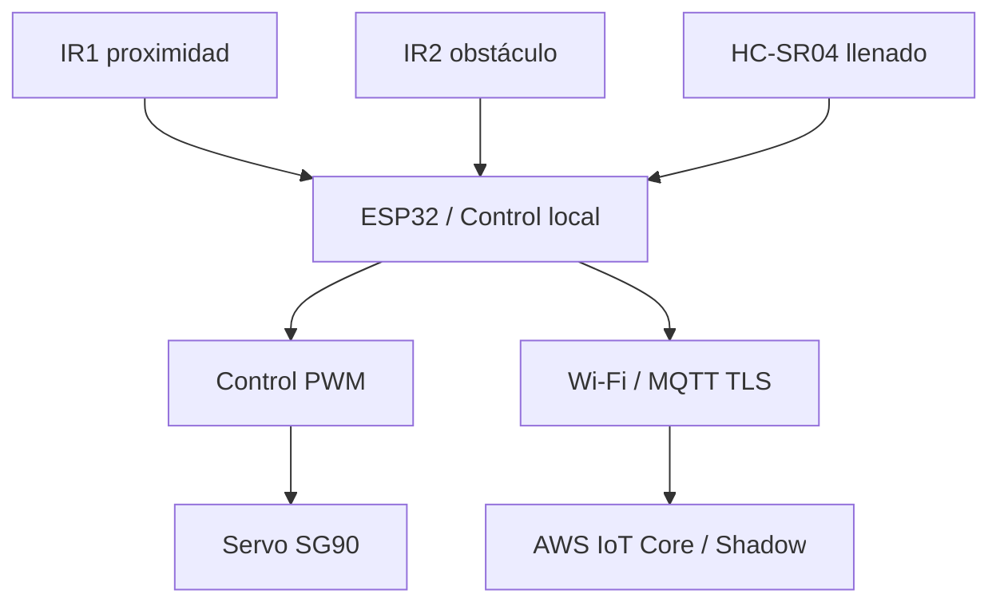
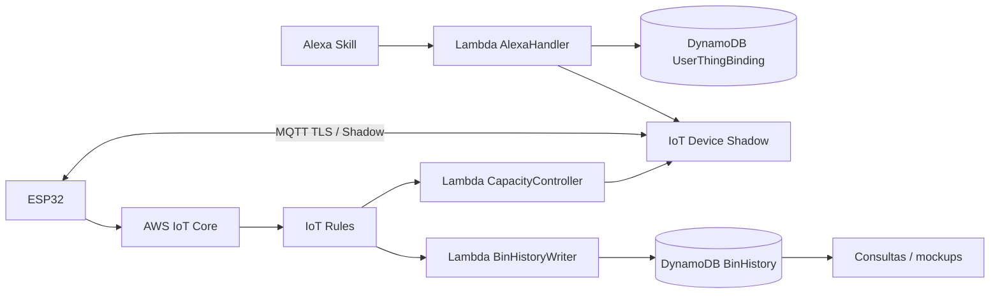
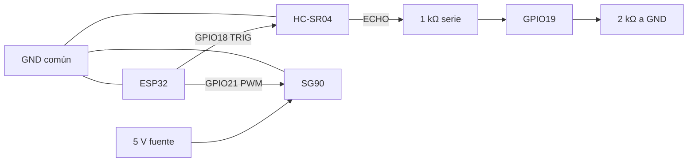
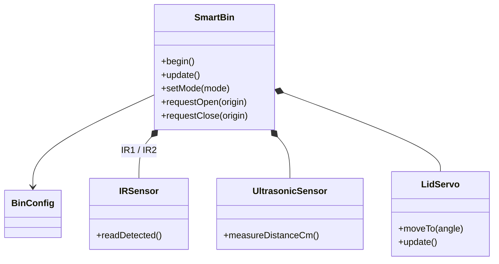
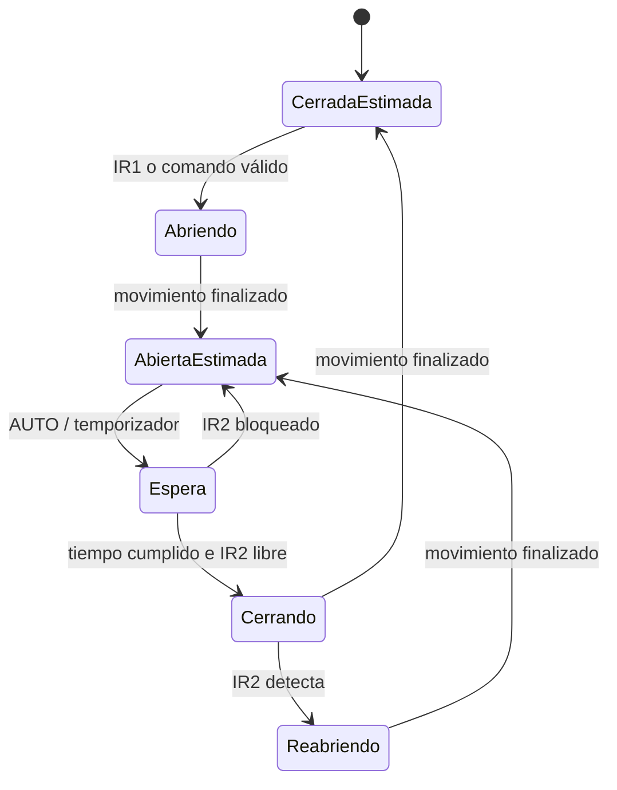
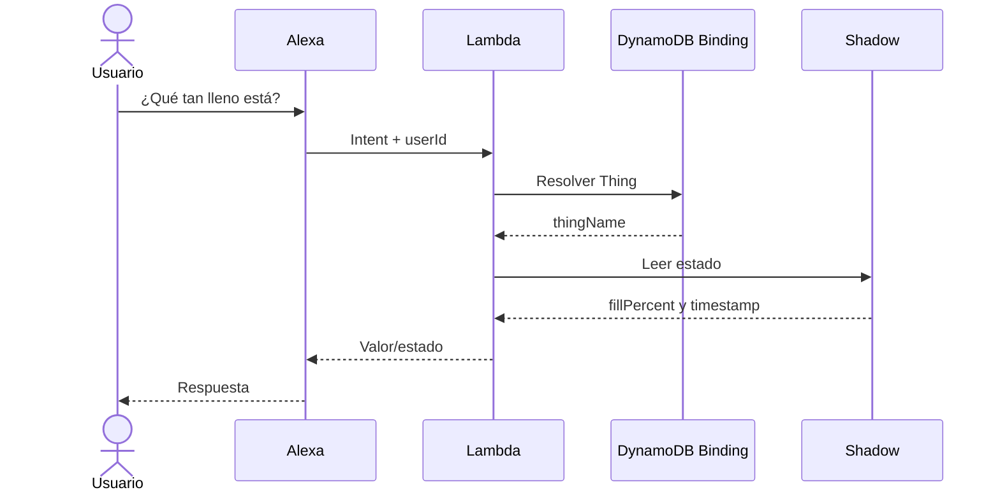
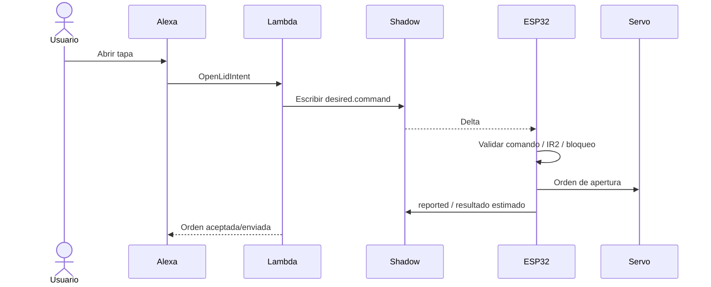
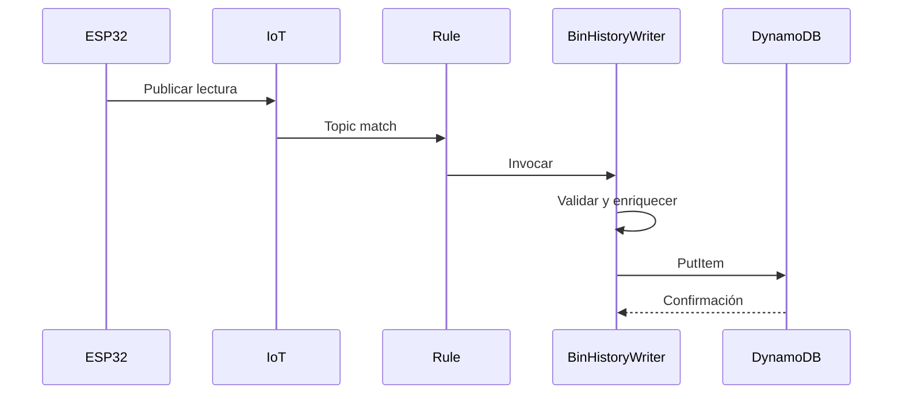
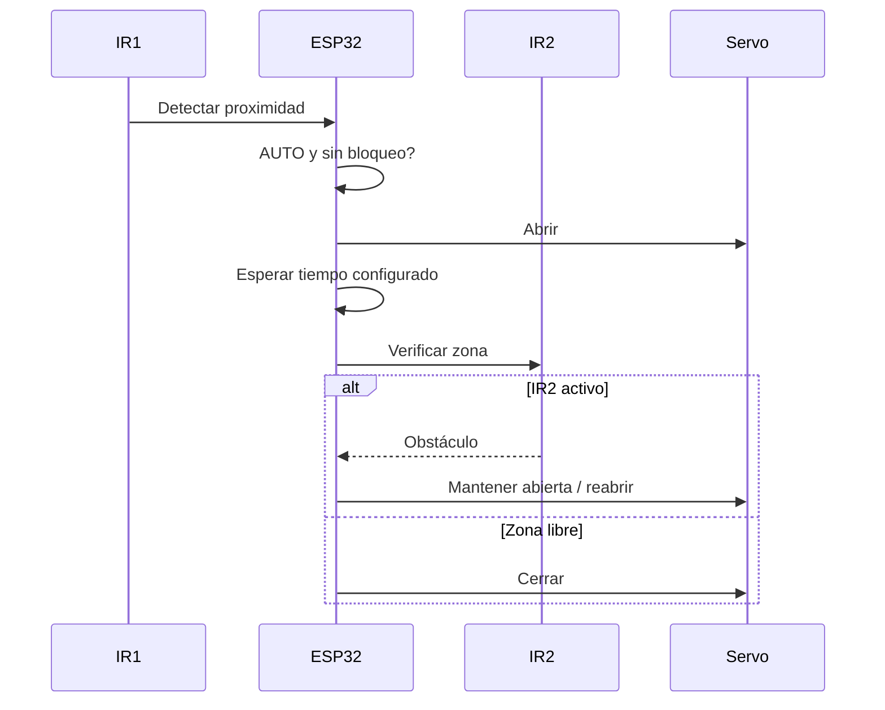
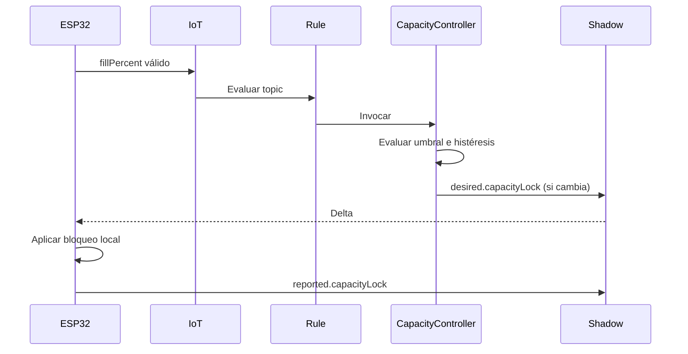

# Práctica 4 — Basurero Inteligente con AWS IoT y Alexa

**Proyecto:** Basurero inteligente  
**Plataforma:** ESP32 / PlatformIO  
**Asignatura:** SIS-234 – IoT  
**Integrantes:** Lucas Rodriguez , Josue Camacho , Pablo Raya  
**Docente:** Eduardo Marin  
**Fecha:** 24-11-26  
**Repositorio:https://github.com/Lucas-RodriguezAncieta/Practica4_IoT_BasureroInteligente 

> **Estado:** documento de diseño y validación. Los resultados y métricas deben completarse con pruebas reales y sus evidencias.

## 1. Caso de uso y requerimientos

### 1.1. Descripción

El basurero inteligente automatiza la apertura y cierre de la tapa, detecta obstáculos en la zona de cierre y mide el nivel de llenado. El ESP32 realiza el control local para mantener las funciones principales sin Internet. AWS IoT Core y Device Shadow sincronizan datos y comandos; Lambda procesa telemetría y lógica de capacidad; DynamoDB conserva lecturas y eventos; Alexa permite consultar y controlar el dispositivo por voz.

### 1.2. Objetivo

Implementar un basurero inteligente que combine control local, medición de llenado, comunicación segura con AWS, almacenamiento histórico y control por Alexa.

### 1.3. Componentes y justificación

| Componente | Función |
|---|---|
| ESP32 DevKit | Control de sensores, servo y conectividad Wi-Fi. |
| IR1 | Detecta proximidad frontal y solicita apertura en modo AUTO. |
| IR2 | Detecta obstáculos en la zona supervisada de cierre. |
| HC-SR04 | Mide distancia a los residuos para estimar llenado. |
| SG90 | Mueve la tapa; no ofrece confirmación física de posición. |
| AWS IoT Core / Shadow | Comunicación MQTT segura y sincronización de estados/órdenes. |
| AWS IoT Rules | Enruta telemetría y eventos a Lambdas. |
| AWS Lambda | Validación/almacenamiento, lógica de capacidad y backend de Alexa. |
| DynamoDB | Guarda histórico y vinculación usuario–Thing. |
| Alexa Skill | Consultas y comandos por voz. |

### 1.4. Requerimientos funcionales

> Los RF01–RF09 originales de la Práctica 3 deben copiarse y verificarse literalmente. La tabla resume el alcance funcional del basurero y la ampliación de esta práctica.

| ID | Requerimiento | Verificación |
|---|---|---|
| RF01 | Detectar proximidad | IR1 detecta y libera correctamente. |
| RF02 | Abrir/cerrar tapa | El servo ejecuta órdenes permitidas. |
| RF03 | Proteger el cierre | IR2 impide o interrumpe el cierre ante obstáculo. |
| RF04 | Cierre temporizado | Cierra tras el tiempo configurado, si IR2 está libre. |
| RF05 | Medir llenado | Calcula porcentaje calibrado entre 0 y 100 %. |
| RF06 | Publicar telemetría y eventos | Los mensajes incluyen dispositivo, tiempo y datos relevantes. |
| RF07 | Consultar estado por Alexa | Consulta llenado, tapa, modo y parámetros. |
| RF08 | Control por Alexa | Comandos se validan y envían mediante Shadow. |
| RF09 | Operación offline | Funciones esenciales siguen en Edge y se recupera conexión. |
| RF10 | Procesar datos en AWS | IoT Rules activan Lambda para validar y enrutar. |
| RF11 | Guardar lecturas | Lambda almacena mediciones válidas en DynamoDB. |
| RF12 | Guardar eventos | Se registran cambios/órdenes y origen cuando está disponible. |
| RF13 | Lógica de capacidad | Cloud actualiza bloqueo en Shadow y Edge lo aplica. |
| RF14 | Sincronizar parámetros | Shadow conserva modo y parámetros en reported; comandos llegan por desired. |
| RF15 | Diseñar reportes | Mockups basados en datos de DynamoDB para apoyar decisiones. |

### 1.5. Requerimientos no funcionales

| ID | Requerimiento | Métrica / criterio propuesto |
|---|---|---|
| RNF01 | Integridad de datos | Almacenar ≥99 % de mensajes válidos durante la prueba. |
| RNF02 | Latencia almacenamiento | Objetivo ≤5 s; registrar mediana, P95 y máximo si es posible. |
| RNF03 | Respuesta Edge | IR1 a inicio de movimiento: objetivo ≤500 ms. |
| RNF04 | Respuesta Cloud | Comando a inicio de movimiento: objetivo ≤5 s bajo red estable. |
| RNF05 | Offline | Control local funciona sin Internet; registrar pérdidas y recuperación. |
| RNF06 | Seguridad eléctrica | GPIO de ESP32 no recibe más de 3,3 V; fuente adecuada para servo y GND común. |
| RNF07 | Seguridad cloud | TLS/certificados, permisos limitados y secretos fuera del repositorio. |
| RNF08 | Modularidad | Código organizado, build reproducible y configuración centralizada. |
| RNF09 | Recuperación | Registrar tiempo de reconexión y sincronización de Shadow. |
| RNF10 | Costos | Estimar IoT, Lambda, DynamoDB y logs según uso mensual. |

## 2. Análisis y diseño

### 2.1. Control del objeto (Edge)

El ESP32 controla sensores, servo y máquina de estados. IR1 solicita apertura en AUTO; IR2 tiene prioridad para impedir el cierre cuando detecta un obstáculo. El HC-SR04 mide el llenado cuando la tapa está en condición estable. El servo se mueve entre posiciones calibradas. Como el SG90 no tiene realimentación, el estado de tapa debe indicarse como **estimado**, no como posición físicamente confirmada.

### 2.2. Diagrama de bloques



### 2.3. Arquitectura AWS



Alexa y Lambda no controlan GPIO directamente. Los comandos se escriben en `desired`; el ESP32 recibe el delta, valida condiciones, ejecuta localmente y actualiza `reported` con el estado estimado/aplicado.

### 2.4. Conexiones eléctricas

> **Confirmar el pin del servo antes de entregar:** la propuesta y README presentan GPIO25 y GPIO21 respectivamente. La tabla usa GPIO21 de forma provisional; corregirla según `BinConfig.h` y cableado real.

| Módulo | ESP32 | Nota |
|---|---|---|
| IR1 OUT | GPIO27 | Verificar nivel lógico/polaridad (máximo 3,3 V). |
| IR2 OUT | GPIO26 | Verificar nivel lógico/polaridad (máximo 3,3 V). |
| HC-SR04 TRIG | GPIO18 | Salida digital. |
| HC-SR04 ECHO | GPIO19 con divisor resistivo | Reducir señal de 5 V a nivel seguro; no conectar directo. |
| SG90 señal | GPIO21 (provisional) | PWM; servo con fuente de 5 V apropiada. |
| Alimentación | 5 V y GND común | Verificar corriente del servo y evitar reinicios. |

Divisor ECHO propuesto: ECHO → 1 kΩ → GPIO19; GPIO19 → 2 kΩ → GND. Verificar voltaje con multímetro antes de energizar.



### 2.5. Módulos y clases

Los nombres deben cotejarse con el código real del repositorio.

| Módulo/clase | Responsabilidad |
|---|---|
| `BinConfig` | Pines, tiempos, ángulos, calibración y umbrales. |
| `SmartBin` | Coordina sensores, modos, estados y acciones. |
| Sensor IR | Lee detección y aplica filtrado si está implementado. |
| UltrasonicSensor | Mide distancia, valida muestras y calcula nivel. |
| Servo/LidController | Controla recorrido y movimiento de tapa. |
| Máquina de estados | Gestiona abrir, espera, cerrar y protección IR2. |
| Lambdas | Separan almacenamiento, lógica de capacidad y backend Alexa. |



### 2.6. Máquina de estados y prioridades



Prioridades: (1) IR2 y protección del cierre; (2) comandos manuales autorizados; (3) apertura automática IR1 en AUTO y sin bloqueo de capacidad. MANUAL desactiva apertura automática y temporizador, pero no IR2. El bloqueo por llenado impide apertura automática; el vaciado manual puede permitirse si es seguro.

### 2.7. Calibración de llenado

Calibrar en el recipiente real:
- `D_vacio`: distancia del sensor al fondo con recipiente vacío.
- `D_limite`: distancia al nivel máximo permitido.
- `D_actual`: lectura válida.

```math
Llenado(%) = ((D_vacio - D_actual) / (D_vacio - D_limite)) * 100
```

Limitar el resultado a 0–100 %. Los valores del README (`EMPTY_CM=30`, `FULL_CM=5`) son provisionales hasta medirlos. Se describe filtrado de cinco intentos, descartando inválidos y calculando mediana con al menos tres muestras válidas; confirmar en firmware.

### 2.8. Device Shadow

Alinear nombres con firmware y Lambdas. Esquema resumido:

| Atributo | Tipo | Uso / validación |
|---|---|---|
| `mode` | String | `AUTO` o `MANUAL`. |
| `autoCloseSeconds` | Integer | Tiempo de cierre; rango definido por firmware. |
| `fillAlertThreshold` | Integer | Umbral entre 1 y 100 %. |
| `capacityLock` | Boolean | Bloqueo automático por capacidad. |
| `fillPercent` | Number/null | 0–100; null si inválido. |
| `distanceCm` | Number/null | Distancia validada o null. |
| `lidStateEstimated` | String | OPEN/CLOSED/OPENING/CLOSING estimado. |
| `ir1Detected`, `ir2Blocked` | Boolean | Estados de sensores. |
| `lastMeasurementAt` | String | Timestamp ISO 8601. |
| `lastCommand` | Object | ID, acción, origen y resultado. |

`desired` contiene parámetros/comandos solicitados; `reported` contiene los valores aplicados y estados reportados. El ESP32 valida los comandos, evita duplicados y mantiene prioridad de IR2. Sin realimentación, el estado de servo no confirma posición física.

### 2.9. Tópicos MQTT

| Tópico | Dirección | Propósito |
|---|---|---|
| `$aws/things/{THING}/shadow/get` | ESP32 → AWS | Solicitar estado Shadow. |
| `$aws/things/{THING}/shadow/update` | Dispositivo/backend → AWS | Actualizar `desired`/`reported`. |
| `$aws/things/{THING}/shadow/update/delta` | AWS → ESP32 | Recibir cambios pendientes. |
| `$aws/things/{THING}/shadow/update/accepted` | AWS → clientes | Confirmación de actualización. |
| `$aws/things/{THING}/shadow/update/rejected` | AWS → clientes | Error de actualización. |
| `basurero/{THING}/telemetria` | ESP32 → AWS | Lecturas y estado periódico. |
| `basurero/{THING}/eventos` | ESP32 → AWS | Aperturas, cierres, órdenes y alertas. |

El firmware documenta una cola RAM de 16 eventos y QoS 0; por ello la entrega de eventos no es garantizada y puede haber pérdidas durante desconexiones o saturación.

### 2.10. Modelo DynamoDB

**`UserThingBinding`**
| Atributo | Tipo | Clave/uso |
|---|---|---|
| `alexaUserId` | String | Partition Key del usuario. |
| `thingName` | String | Thing vinculado. |
| `createdAt`, `updatedAt` | String | Fechas de vínculo. |
| `status` | String | Estado de vínculo. |

**`BinHistory`**
| Atributo | Tipo | Clave/uso |
|---|---|---|
| `thingName` | String | Partition Key. |
| `timestampId` | String | Sort Key (timestamp e identificador único). |
| `recordType` | String | TELEMETRIA, EVENTO o ALERTA. |
| `fillPercent`, `distanceCm` | Number | Medición, si válida. |
| `lidStateEstimated`, `mode` | String | Estado estimado y modo. |
| `action`, `origin` | String | Evento y origen (edge/voz/nube/serie). |
| `eventId` | String | Identificador para deduplicación. |
| `valid` | Boolean | Validación de lectura. |
| `receivedAt` | String | Recepción en backend. |

**Consultas previstas:** último estado, histórico por Thing y rango de tiempo, eventos, alertas y conteos por origen. La clave `thingName` + `timestampId` permite consultas por dispositivo y período. Un GSI se añadirá solo si se requiere consultar globalmente por tipo. TTL es opcional y debe definirse según política de retención.

### 2.11. IoT Rules y Lambda

SQL de referencia; probar y ajustar al payload real:

```sql
SELECT * FROM 'basurero/+/telemetria'
```
**Acción:** invocar `BinHistoryWriter`.

```sql
SELECT * FROM 'basurero/+/eventos'
```
**Acción:** invocar `BinHistoryWriter`.

| Lambda | Función | Disparador / recursos |
|---|---|---|
| `BinHistoryWriter` | Validar, obtener Thing desde tópico, añadir timestamp, evitar duplicados si implementado y guardar histórico. | IoT Rules; DynamoDB `BinHistory`. |
| `CapacityController` | Evaluar llenado; bloquear ≥90 % y liberar ≤80 % (propuesta); actualizar `desired.capacityLock` solo ante cambio. | Rule; Device Shadow. |
| `AlexaHandler` | Resolver usuario a Thing, consultar Shadow, validar intents y escribir comandos/parametros en `desired`. | Alexa Skill; Binding table; Shadow. |

Lambda no controla GPIO. El ESP32 aplica cambios recibidos. Permisos IAM deben limitarse a recursos necesarios (por ejemplo, `PutItem` para writer y `UpdateThingShadow` para controlador), documentando permisos más amplios si fueran necesarios durante la práctica.

### 2.12. Skill Alexa

**Nombre de invocación sugerido:** “basurero inteligente” (confirmar en Developer Console).
| Intent | Slot | Ejemplo |
|---|---|---|
| `GetFillIntent` | — | ¿Qué tan lleno está? |
| `GetLidIntent` | — | ¿La tapa está abierta? |
| `GetModeIntent` | — | ¿Está en automático? |
| `OpenLidIntent` | — | Abre el basurero. |
| `CloseLidIntent` | — | Cierra la tapa. |
| `SetModeIntent` | `mode` | Activa modo automático / manual. |
| `SetThresholdIntent` | `percent` (1–100) | Configura alerta al 85 %. |
| `GetThresholdIntent` | — | ¿Cuál es el umbral? |
| Amazon intents | — | Ayuda, cancelar, detener. |

Flujo: Alexa → Lambda → resolver usuario/Thing → leer o actualizar Shadow → ESP32 recibe delta, valida y ejecuta → reporta estado estimado → Alexa responde. La respuesta no debe afirmar posición física confirmada.

### 2.13. Secuencias principales

**Consulta de sensor por Alexa**


**Comando de actuador por voz**


**Telemetría a almacenamiento**


**Regla automática Edge: tapa**


**Regla automática Cloud: capacidad**


### 2.14. Edge vs Cloud

| Función | Ubicación | Motivo |
|---|---|---|
| Sensores, servo, temporizador y protección IR2 | Edge | Respuesta inmediata y funcionamiento offline. |
| Medición y validación inicial | Edge | Evita depender de red para lectura. |
| Histórico, consultas y reportes | Cloud | Persistencia y análisis de datos. |
| Bloqueo por capacidad | Cloud decide; Edge aplica | Permite actualizar lógica remotamente, manteniendo respuesta local. |
| Alexa y vinculación | Cloud | Gestión de usuario, intents y Shadow. |

### 2.15. Mockups de reportes

Mockups de diseño, no dashboards implementados. Los ejemplos de valores deben sustituirse por datos reales.

**A. Estado actual:** nivel, tapa estimada, modo, umbral y fecha de última lectura. Fuente: Shadow y último registro de `BinHistory`.

| Dispositivo | Llenado | Tapa estimada | Modo | Última lectura |
|---|---:|---|---|---|
| basurero-grupoX-01 | Ejemplo 72 % | Cerrada | AUTO | Ejemplo 10:15 UTC |

**B. Histórico de llenado:** gráfica de `fillPercent` por hora/fecha, consulta por `thingName` y rango temporal.

| Hora (ejemplo) | Llenado |
|---|---:|
| 08:00 | 40 % |
| 09:00 | 48 % |
| 10:00 | 57 % |

**C. Eventos:** apertura, cierre, alertas, comando y origen. Fuente: `BinHistory` por Thing y período.
| Fecha/hora (ejemplo) | Evento | Origen |
|---|---|---|
| 10:02 | Apertura | Edge |
| 10:45 | Alerta de capacidad | Cloud |

**D. Resumen de actividad:** conteos de aperturas/cierres, alertas y comandos de voz, calculados sobre eventos históricos. Todos los valores de mockup son ilustrativos.

### 2.16. Estimación de tráfico y costos

Con una publicación cada 30 s durante 30 días: `2.880 mensajes/día × 30 = 86.400 mensajes/mes` por Thing. Si se envían actualizaciones Shadow a la misma frecuencia, sumar hasta otras 86.400 actualizaciones mensuales, además de eventos, comandos y reintentos. Estimar invocaciones Lambda y operaciones DynamoDB a partir de las reglas y consultas realmente configuradas. Este cálculo representa volumen, no precio; completar el costo con región, tarifas vigentes, tamaño de mensajes, logs y capa gratuita, y configurar una alerta de presupuesto.

## 3. Desarrollo e implementación

### 3.1. Estructura del repositorio

Adaptar a los archivos reales:
```text
├── include/ (configuración y headers)
├── src/ (main y clases del basurero/sensores/servo)
├── test/ (plan de pruebas, resultados y evidencias)
├── aws/ (Rules SQL, políticas, Lambdas y esquema DynamoDB)
├── docs/ (diagramas, mockups y capturas)
├── platformio.ini
└── .gitignore
```

### 3.2. Firmware y control

La configuración debe centralizar pines, polaridad IR, tiempos, posiciones del servo, rangos y umbrales. El servo debe probarse con la tapa real, evitando topes y sobrecarga. El SG90 no confirma posición; el sistema reporta estado estimado.

### 3.3. Comunicación y tolerancia a fallos

El firmware descrito utiliza Wi-Fi, MQTT TLS (puerto 8883), certificados X.509, Shadow clásico, PubSubClient y ArduinoJson. El control local debe continuar sin red. La cola de 16 eventos en RAM y QoS 0 no garantizan persistencia: documentar pérdidas y recuperación.

### 3.4. Configuración AWS y seguridad

| Recurso | Configuración/evidencia a documentar |
|---|---|
| IoT Thing | Nombre, certificado y estado (sin exponer secretos). |
| Política IoT | Topics y acciones permitidas, alcance por Thing. |
| IoT Rules | SQL, topics, acciones y Lambda destino. |
| Lambda | Trigger, función, variables no sensibles, recursos y logs. |
| DynamoDB | Tablas, claves, índices, TTL si aplica, región. |
| Alexa | Intents/slots, frases, Lambda endpoint y Simulator. |
| IAM | Permisos asignados y justificación; mínimo privilegio. |
| Secretos | Certificados, claves y Wi-Fi excluidos de Git; plantilla de ejemplo. |

### 3.5. Parámetros iniciales

| Parámetro | Valor de referencia | Estado |
|---|---:|---|
| IR1 / IR2 | GPIO27 / GPIO26 | Confirmar en firmware. |
| TRIG / ECHO | GPIO18 / GPIO19 | Confirmar divisor ECHO. |
| Servo | GPIO21 (discrepancia con GPIO25) | Verificar antes de entregar. |
| Ángulo cerrado / abierto | 0° / 90° | Calibrar. |
| Movimiento servo | 1° cada 20 ms | Confirmar implementación. |
| Tiempo abierto | 5 s mínimo | Verificar configuración. |
| Bloqueo / liberación | 90 % / 80 % | Valores propuestos; confirmar código. |
| Lectura de llenado | 2 s propuesta | Confirmar firmware. |
| Publicación telemetría | 30 s descrito | Confirmar firmware. |
| Cola de eventos | 16 elementos RAM | Confirmar firmware. |
| Medición ultrasónica | 5 intentos, ≥3 válidos | Confirmar firmware. |

## 4. Pruebas y validaciones

Se utilizará el plan de **20 pruebas esenciales** del archivo `test/README.md` (o el documento de pruebas del repositorio). Registrar para cada prueba: fecha, responsable, commit, condiciones, resultado, métrica y evidencia. Estados válidos: `APROBADO`, `FALLIDO`, `BLOQUEADO`, `NO APLICA`. No marcar como aprobado sin evidencia.

### Evidencias mínimas

- Fotos del prototipo y montaje/circuito, GPIO y divisor ECHO.
- Build PlatformIO y logs del monitor serie.
- Videos de apertura, cierre, IR2 y ciclos mecánicos.
- Calibración y datos de medición de llenado.
- MQTT Test Client, Shadow `desired/reported`, Rule SQL/acciones y logs Lambda.
- Items y consultas DynamoDB (ocultar datos personales).
- Alexa Simulator para consultas y comandos.
- Offline, reconexión y métricas.
- `.gitignore`, políticas IoT/IAM sin certificados ni claves privadas.

## 5. Resultados

Completar con datos reales al finalizar la campaña.

### 5.1. Estado de implementación

| Elemento | Estado | Evidencia |
|---|---|---|
| Firmware y compilación | [Completar] | [Build/commit] |
| Sensores y servo | [Completar] | [T01–T09] |
| Wi-Fi, MQTT TLS y Shadow | [Completar] | [T10–T12] |
| IoT Rules y Lambda | [Completar] | [T13] |
| DynamoDB histórico | [Completar] | [T14–T16] |
| Alexa y vinculación | [Completar] | [T17–T19] |
| Lógica Edge/Cloud | [Completar] | [T20] |
| Mockups de reportes | [Completar] | [Capturas/consultas] |

### 5.2. Métricas

| Métrica | Objetivo | Resultado | Cumple |
|---|---|---|---|
| Apertura Edge | ≤500 ms | [Medir] | [Sí/No] |
| IR2 a reacción | Registrar | [Medir] | [Sí/No] |
| Comando Cloud | ≤5 s | [Medir] | [Sí/No] |
| Escritura DynamoDB | ≤5 s | [Medir] | [Sí/No] |
| Integridad de datos | ≥99 % | [Medir] | [Sí/No] |
| Error de llenado | ≤10 pp | [Medir] | [Sí/No] |
| Reconexión MQTT/Shadow | Registrar | [Medir] | [Sí/No] |
| Eventos perdidos offline | Cuantificar | [Medir] | [Informar] |
| Ciclos mecánicos | 20 ciclos | [Medir] | [Sí/No] |
| Costo mensual AWS | Estimación | [Calcular] | [Documentar] |

### 5.3. Análisis

Analizar precisión y repetibilidad del sensor, respuesta Edge/Cloud, cobertura de IR2, integridad y latencia del almacenamiento, privacidad multiusuario, histéresis y reconexión. Documentar fallos, causas, correcciones y limitaciones. No sustituir resultados medidos por valores esperados.

## 6. Conclusiones

El proyecto combina control local y servicios cloud. Las funciones de tapa y protección se ubican en el ESP32 para reducir latencia y mantener operación offline. AWS IoT Core y Shadow sincronizan parámetros y comandos; Rules y Lambda procesan datos; DynamoDB permite conservar históricos; Alexa proporciona una interfaz de voz. La evaluación final dependerá de la calibración, estabilidad mecánica, cobertura real de sensores, seguridad eléctrica, validación de AWS y métricas obtenidas.

