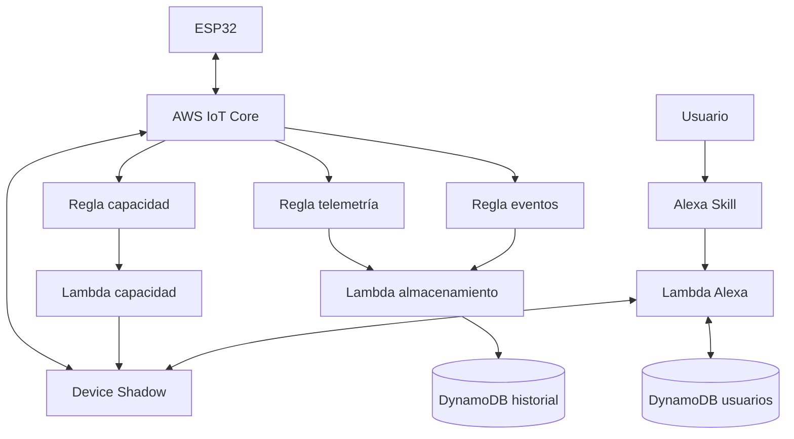

# Arquitectura AWS — Basurero Inteligente

[Volver al índice](README.md)

## Objetivo

Integrar el basurero físico con AWS para almacenar información, ejecutar lógica de control y atender comandos de voz.

Se utiliza una arquitectura orientada a eventos, basada en MQTT sobre TLS y funciones Lambda.

## Servicios

| Componente | Responsabilidad |
|---|---|
| ESP32 | Lectura de sensores y control del servomotor |
| AWS IoT Core | Comunicación MQTT y administración de Things |
| Device Shadow | Estado deseado y reportado |
| IoT Rules | Enrutamiento de telemetrías y eventos |
| Lambda | Almacenamiento, capacidad y Alexa |
| DynamoDB | Historial y vinculaciones |
| Alexa Skills Kit | Interfaz de voz |
| IAM | Control de permisos |
| CloudWatch | Registros y diagnóstico |

## Diagrama de arquitectura

## Rutas de comunicación

### Almacenamiento
`ESP32 → MQTT → Regla IoT → Lambda almacenamiento → DynamoDB`

### Control automático
`ESP32 → MQTT → Regla capacidad → Lambda capacidad → desired del Shadow`

### Control por Alexa
`Usuario → Alexa → Lambda Alexa → Shadow → ESP32`

Las solicitudes de Alexa no controlan directamente el ESP32: modifican el estado deseado del Shadow.

## Procesamiento Edge y Nube

| Ubicación | Responsabilidad |
|---|---|
| Edge (ESP32) | Sensores, movimiento de tapa, seguridad local y cierre temporizado |
| Nube | Historial, vinculación de usuarios y decisión de bloqueo por capacidad |

Se mantienen restricciones locales de seguridad para responder rápidamente, incluso cuando la comunicación con AWS presenta problemas.

La nube facilita modificar configuraciones sin volver a cargar el firmware.

## Separación de Lambdas

Se implementaron tres funciones para separar:
1. Persistencia de datos.
2. Decisiones automáticas de capacidad.
3. Interacción con Alexa.

Esto facilita mantenimiento, pruebas y permisos IAM específicos.

## Multi-Thing

La arquitectura utiliza nombres dinámicos de Thing.

| Thing | Tipo |
|---|---|
| `basurero-grupo3-01` | ESP32 físico |
| `basurero-grupo3-02` | Simulado |

Las reglas MQTT utilizan comodines y Alexa identifica el Thing vinculado consultando DynamoDB.

## Documentación relacionada

- [IoT Core y Shadow](02-iot-core-y-device-shadow.md)
- [Reglas MQTT](03-reglas-iot-y-mqtt.md)
- [Lambdas](04-funciones-lambda.md)
- [Multi-Thing](07-vinculacion-multithing.md)
