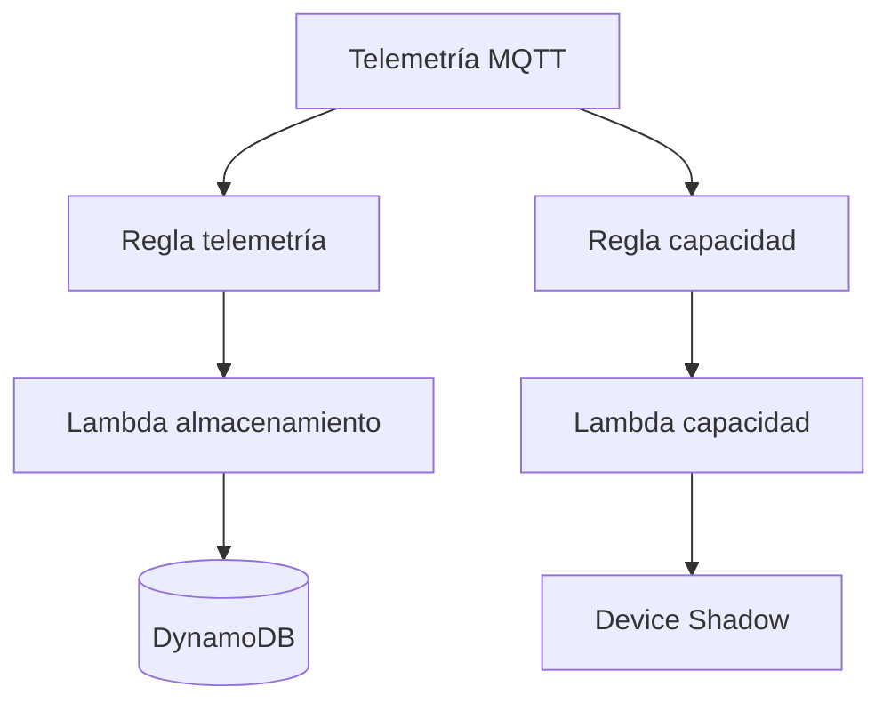

# Reglas AWS IoT y MQTT

[Volver al índice](README.md)

## Objetivo

Utilizar AWS IoT Rules para seleccionar mensajes MQTT e invocar las Lambdas de almacenamiento y control automático.

Se configuraron tres reglas independientes.

## Estructura de tópicos

```text
basurero/{thingName}/telemetria
basurero/{thingName}/eventos
```

El comodín MQTT `+` permite que las reglas procesen mensajes de diferentes Things.

La función SQL `topic(2)` recupera el nombre del dispositivo desde el segundo segmento del tópico.

## Reglas configuradas

| Regla | Filtro MQTT | Lambda |
|---|---|---|
| `basurero_regla_telemetria` | `basurero/+/telemetria` | `basurero_almacenamiento` |
| `basurero_regla_eventos` | `basurero/+/eventos` | `basurero_almacenamiento` |
| `basurero_regla_capacidad` | `basurero/+/telemetria` | `basurero_control_capacidad` |

## 1. Regla de telemetría

**SQL:** [telemetria.sql](config/reglas/telemetria.sql)

Selecciona todos los campos del mensaje y agrega:
- `thingName`: nombre del Thing.
- `recordType = TELEMETRIA`.
- `receivedAt`: instante de procesamiento.

**Destino:** Lambda `basurero_almacenamiento`.

**Resultado:** registro en `basurero_historial`.

## 2. Regla de eventos

**SQL:** [eventos.sql](config/reglas/eventos.sql)

Selecciona mensajes del tópico de eventos y agrega:
- `thingName`.
- `recordType = EVENTO`.
- `receivedAt`.

**Destino:** Lambda `basurero_almacenamiento`.

Los mensajes pueden incluir `origin` y `commandId` para identificar la procedencia de acciones.

Una actualización del Shadow no genera automáticamente un evento MQTT: el componente correspondiente debe publicarlo.

## 3. Regla de capacidad

**SQL:** [capacidad.sql](config/reglas/capacidad.sql)

Selecciona `thingName` y `fillPercent`.

Su condición `WHERE` descarta mensajes que no tienen definido `fillPercent`.

**Destino:** Lambda `basurero_control_capacidad`.

Esta Lambda evalúa la histéresis y puede actualizar `desired.capacityLock`.

## Enrutamiento



Una publicación de telemetría puede activar ambas reglas. Sus ejecuciones son independientes y no tienen un orden de finalización garantizado.

## Multi-Thing

Las mismas reglas procesan:
- `basurero-grupo3-01`
- `basurero-grupo3-02`

No fue necesario duplicarlas. Para habilitar el segundo Thing se amplió el permiso IAM de la Lambda de capacidad.

## Pruebas

Con el Thing 02 se enviaron mediciones simuladas de 95 %, 85 % y 80 %.

Se verificó el almacenamiento en DynamoDB y la actualización del bloqueo en su Shadow.

## Referencias

- [AWS IoT Rules](https://docs.aws.amazon.com/iot/latest/developerguide/iot-rules.html)
- [Referencia SQL](https://docs.aws.amazon.com/iot/latest/developerguide/iot-sql-reference.html)
