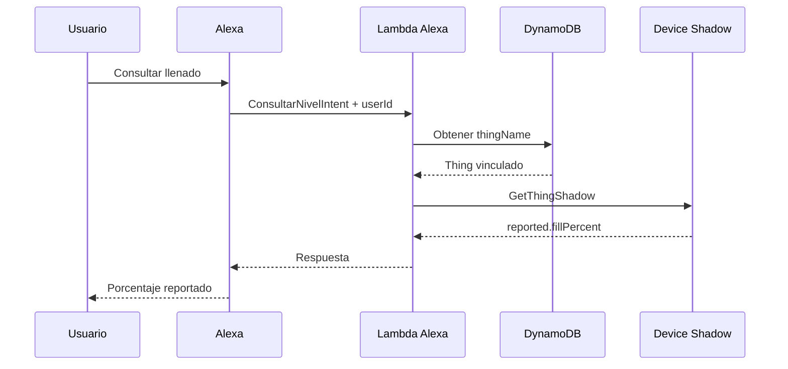

# Alexa Skill — Basurero Inteligente

[Volver al índice](README.md)

## Configuración

| Parámetro | Valor |
|---|---|
| Skill | `Basurero Inteligente` |
| Invocación | `basurero inteligente` |
| Idioma | Español México (`es-MX`) |
| Backend | `basurero_alexa` |
| Región Lambda | `us-east-2` |
| Entorno de pruebas | Alexa Developer Console |

Alexa envía solicitudes a la Lambda, que identifica al usuario y consulta o modifica el Shadow correspondiente.

## Modelo de interacción

El modelo contiene intents personalizados, slots y frases de ejemplo.

| Intent | Slot | Función |
|---|---|---|
| `VincularBasureroIntent` | `codigo` | Vincular un Thing |
| `DesvincularBasureroIntent` | — | Eliminar vinculación |
| `AbrirTapaIntent` | — | Solicitar apertura |
| `CerrarTapaIntent` | — | Solicitar cierre |
| `CambiarModoIntent` | `modo` | Cambiar modo |
| `CambiarUmbralIntent` | `porcentaje` | Modificar umbral |
| `CambiarRetardoIntent` | `segundos` | Modificar cierre automático |
| `ConsultarNivelIntent` | — | Consultar llenado |
| `ConsultarTapaIntent` | — | Consultar tapa |
| `ConsultarModoIntent` | — | Consultar modo |
| `ConsultarUmbralIntent` | — | Consultar umbral |
| `ConsultarRetardoIntent` | — | Consultar tiempo de cierre |
| `ConsultarSensoresIntent` | — | Consultar sensores |
| `ConsultarBloqueoIntent` | — | Consultar bloqueo por capacidad |

También se manejan intents estándar como ayuda, detener y cancelar.

El modelo completo, incluidas sus frases y tipos de slots, debe exportarse desde la consola:

[interaction-model.json](config/alexa/interaction-model.json)

## Comandos de demostración

| Acción | Frase |
|---|---|
| Consultar llenado | Pregúntale a basurero inteligente cuál es el nivel de llenado |
| Abrir | Dile a basurero inteligente que abra la tapa |
| Cerrar | Dile a basurero inteligente que cierre la tapa |
| Modo manual | Dile a basurero inteligente que cambie a modo manual |
| Modo automático | Dile a basurero inteligente que cambie a modo automático |
| Consultar tapa | Pregúntale a basurero inteligente cuál es el estado de la tapa |
| Consultar bloqueo | Pregúntale a basurero inteligente si el basurero está bloqueado |
| Consultar sensores | Pregúntale a basurero inteligente si detecta un obstáculo |
| Consultar retardo | Pregúntale a basurero inteligente cuál es el tiempo de cierre automático |
| Cambiar retardo | Dile a basurero inteligente que configure el cierre automático en 8 segundos |
| Consultar umbral | Pregúntale a basurero inteligente cuál es el umbral de llenado |
| Cambiar umbral | Dile a basurero inteligente que configure el umbral de llenado en 95 por ciento |

Las frases pueden variar según el modelo de interacción compilado.

## Procesamiento de una consulta

## Comandos y configuraciones

Los comandos de tapa se escriben en `desired.command`, incluyendo:
- `id`: identificador del comando.
- `action`: `abrir` o `cerrar`.
- `origin`: `voz`.

Los cambios de configuración se envían a:
- `desired.mode`
- `desired.autoCloseSeconds`
- `desired.fillAlertThreshold`

Las consultas leen `reported`, no modifican los sensores.

## Validaciones de la Lambda

Según el código revisado:
- Modo: `AUTOMATICO` o `MANUAL`.
- Umbral: enteros entre 11 y 100.
- Retardo: enteros entre 1 y 3600 segundos.

## Corrección de ConsultarBloqueoIntent

Inicialmente, la pregunta sobre bloqueo se interpretaba como `ConsultarTapaIntent`.

Se agregó `ConsultarBloqueoIntent` a Lambda y al modelo de Alexa.

Después de compilar, Alexa respondió correctamente que el basurero no estaba bloqueado.

Este intent consulta `reported.capacityLock`.

## Actualización de la Skill

Cuando se modifica un intent:

1. Guardar el modelo.
2. Compilar la Skill.
3. Probar la frase desde Test.
4. Revisar `request.intent.name` en JSON Input si falla.

## Archivos relacionados

- [Lambda Alexa](lambdas/basurero_alexa.py)
- [Modelo de interacción](config/alexa/interaction-model.json)
- [Vinculación Multi-Thing](07-vinculacion-multithing.md)
