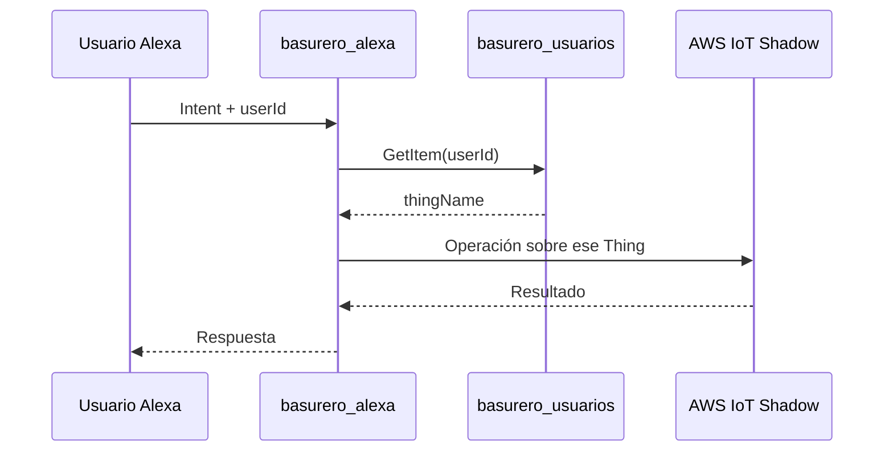

# Vinculación de usuarios y Multi-Thing

[Volver al índice](README.md)

## Objetivo

Permitir que una misma Alexa Skill atienda a distintos usuarios y dirija sus solicitudes al Thing vinculado a cada uno.

La Lambda no depende de un único Thing fijo.

## Things registrados

| Thing | Tipo |
|---|---|
| `basurero-grupo3-01` | ESP32 físico |
| `basurero-grupo3-02` | Simulado |

## Mecanismo de vinculación

La relación se almacena en DynamoDB:

```text
userId → thingName
```

La Lambda utiliza la tabla `basurero_usuarios`.

### Proceso

1. Alexa recibe `VincularBasureroIntent`.
2. La Lambda identifica al usuario mediante `userId`.
3. Obtiene el slot `codigo`.
4. Busca el código en `PAIRING_CODES_JSON`.
5. Verifica que el Thing exista mediante `DescribeThing`.
6. Guarda `{userId, thingName}` en DynamoDB.
7. Confirma la vinculación.

Los códigos reales no se publican en el repositorio.

## Enrutamiento de solicitudes



## Vinculaciones verificadas

| Identidad | Thing |
|---|---|
| Usuario real del simulador Alexa | `basurero-grupo3-01` |
| `usuario-prueba-002` | `basurero-grupo3-02` |

La segunda identidad fue simulada mediante eventos de prueba de AWS Lambda.

Por tanto, la prueba valida el enrutamiento Multi-Thing, pero no representa dos cuentas reales de Alexa.

## Pruebas de independencia

| Prueba | Resultado |
|---|---|
| Consultar nivel Thing 01 | Alexa respondió 82 % |
| Consultar nivel Thing 02 | Lambda respondió 35 % simulado |
| Cambiar Thing 02 a manual | `desired.mode = MANUAL` |
| Verificar Thing 01 | Permaneció en automático |
| Restaurar Thing 02 | Volvió a automático |

## Historial independiente

Las telemetrías se identifican mediante:

```text
basurero/{thingName}/telemetria
```

Las reglas extraen `thingName` y almacenan los registros en `basurero_historial`.

Se verificaron registros del Thing 02 con 95 %, 85 % y 80 %.

## Limitaciones

- Cada `userId` mantiene un Thing vinculado a la vez.
- Vincular otro código desde el mismo usuario reemplaza su asociación.
- El segundo Thing no tiene ESP32 ni certificado propio.
- Las mediciones del segundo Thing son simuladas.
- Una segunda cuenta real de Alexa no se probó.

## Seguridad

La política IAM de Alexa debe autorizar los Things permitidos.

La Lambda de capacidad también requiere permisos sobre cada Thing que controla.

Los permisos Multi-Thing se explican en [08-permisos-iam.md](08-permisos-iam.md).
