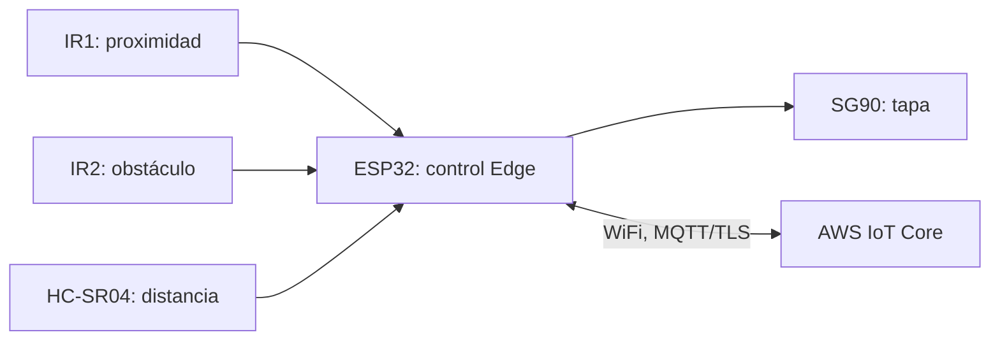
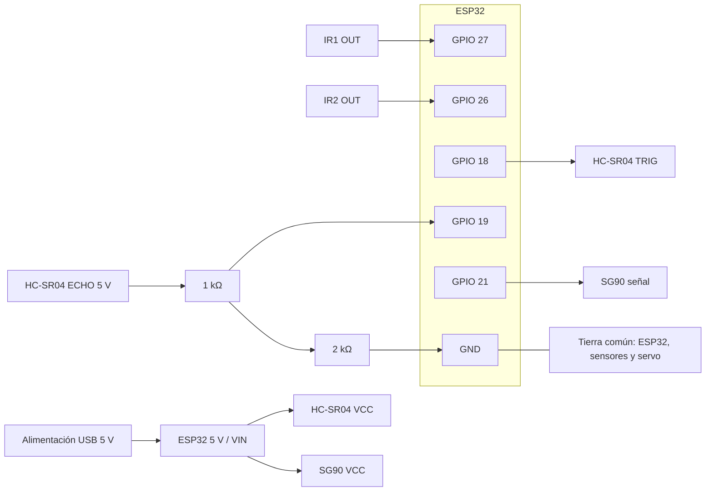
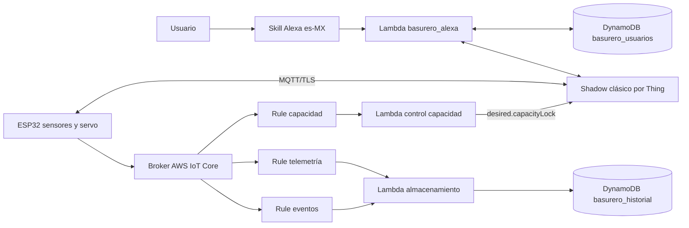
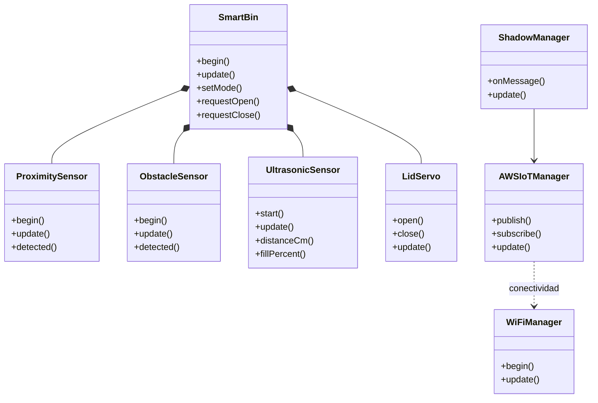
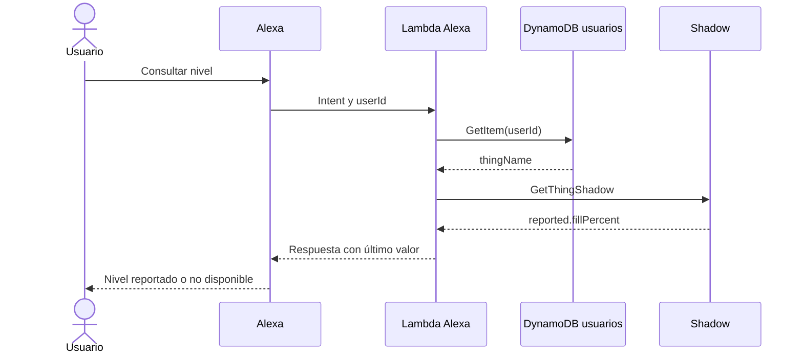
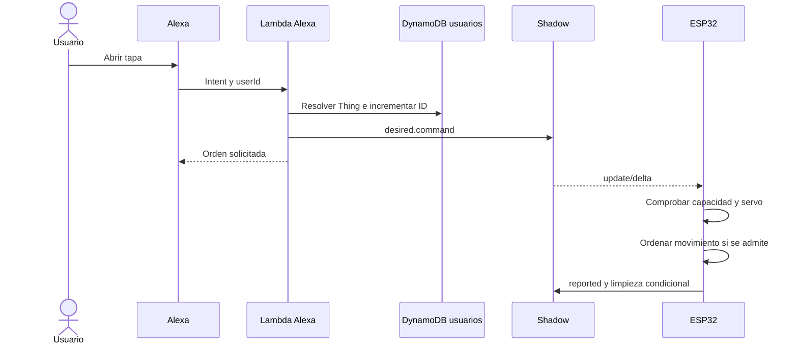
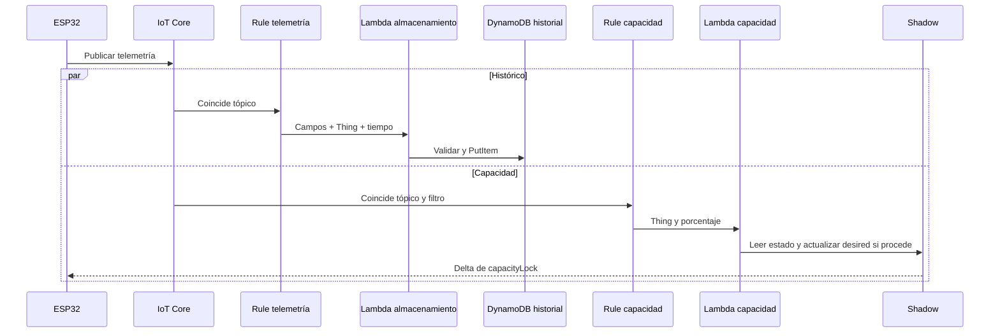
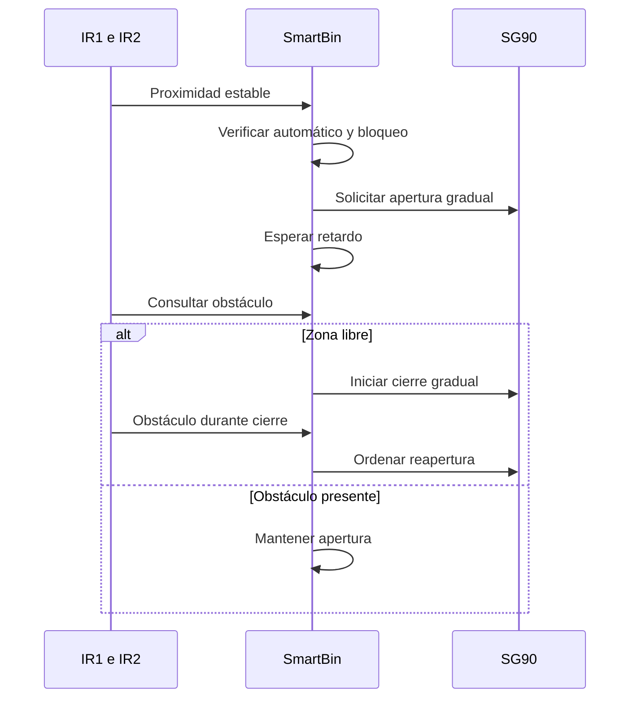

# PRÁCTICA 4 

## BASURERO INTELIGENTE CONECTADO A AWS IoT CORE Y ALEXA

**Grupo:** 3  Lucas Rodriguez - Josue Camacho - Pablo Raya 
**Proyecto:** Sistema de basurero inteligente con control local, monitoreo remoto y asistencia por voz.

---

## 1. Caso de uso y requerimientos

### 1.1 Justificación del cambio de proyecto

La propuesta inicial fue una **puerta inteligente para mascotas**, orientada a automatizar su apertura y cierre mediante un ESP32, sensores y un servomotor. Durante el análisis se identificó la necesidad de distinguir a la mascota autorizada de otros animales que pudieran activar la puerta.

Se consideró utilizar un lector RFID y una etiqueta en el collar. Los módulos convencionales evaluados tenían un alcance aproximado de 3 cm, por lo que la mascota tendría que acercarse a una posición específica. Esto podía requerir adiestramiento o una ubicación cuidadosa del lector, sin garantizar la identificación en todas las ocasiones. También se consideró RFID UHF para aumentar el alcance, pero sus componentes tenían un costo mayor que el presupuesto previsto y aumentaban la complejidad de la solución.

Ante estas limitaciones técnicas y económicas, el equipo planteó al docente cambiar la propuesta por un **basurero inteligente**. Según lo informado por el equipo, el docente aprobó el cambio y solicitó justificarlo en el informe.

El nuevo caso de uso emplea un ESP32, dos sensores infrarrojos, un sensor ultrasónico y un servomotor para automatizar la tapa, detectar posibles obstáculos y estimar el llenado. La integración con AWS y Alexa conserva los objetivos académicos de programación del objeto inteligente, uso de sensores y actuadores y comunicación con servicios en la nube, con componentes accesibles y sin depender de la identificación de mascotas.

El basurero es un **proyecto distinto** de la propuesta anterior. Los requisitos funcionales y no funcionales de la Práctica 3 se aplican al nuevo caso de uso conforme a la Práctica 4; los resultados y evidencias presentados en este informe corresponden al basurero y no se atribuyen a la puerta para mascotas.

### 1.1.1 Problema y solución

El basurero inteligente facilita el depósito de residuos sin tocar la tapa y permite consultar a distancia el estado y el llenado estimado. Un ESP32 lee dos sensores infrarrojos y un ultrasónico, acciona una tapa mediante un SG90 y comunica su estado a AWS. Una skill de Alexa consulta el último estado y solicita cambios mediante el Shadow del Thing asociado al usuario.

En este nuevo caso de uso se aplican los requisitos de control por voz y vinculación usuario–Thing de la Práctica 3 y se añaden las funciones de la Práctica 4: control autónomo local, telemetría, historial y una regla de capacidad en la nube.

| Componente | Cantidad | Función y justificación |
|---|---:|---|
| ESP32 DOIT DevKit V1 | 1 | Procesamiento local, GPIO y comunicación WiFi. |
| IR1 de proximidad | 1 | Detecta la aproximación para abrir sin contacto. |
| IR2 de obstáculos | 1 | Detecta obstáculos en la zona supervisada durante el cierre. |
| HC-SR04 | 1 | La distancia a los residuos permite estimar el nivel de un recipiente de altura física aproximada de 30 cm; su uso responde al caso de uso. |
| SG90 | 1 | Actuador no LED que mueve la tapa; funciona con alimentación de 5 V. |

IR2 no detecta necesariamente todos los obstáculos; el sistema no debe considerarse una protección contra atrapamientos. El estado de la tapa es **estimado**, pues el servo no aporta realimentación de posición.

### 1.2 Requerimientos funcionales y trazabilidad

Los RF1–RF9 de la Práctica 3 se mantienen para los sensores y el actuador del basurero. Los RF10–RF15 corresponden a la ampliación de la Práctica 4. Las matrices relacionan cada requisito con el diseño y sus pruebas.

### 1.2.1 Requerimientos heredados de la Práctica 3

| ID y requerimiento original | Aplicación en el basurero | Diseño e implementación | Prueba y estado documentado |
|---|---|---|---|
| **RF1.** Capturar datos del entorno con su sensor. | Se amplía a dos sensores IR y un HC-SR04 para proximidad, obstáculo y distancia a residuos. | [ProximitySensor](../src/ProximitySensor.cpp), [ObstacleSensor](../src/ObstacleSensor.cpp) y [UltrasonicSensor](../src/UltrasonicSensor.cpp). | T01, T05, T06, T08 y T09: se describen observaciones físicas, pero falta registro formal de los ensayos. |
| **RF2.** Reportar periódicamente el valor del sensor y el estado del actuador en la sección `reported` de su Shadow. | Se reportan los estados IR, distancia, llenado y estado estimado de la tapa. | [ShadowManager](../src/ShadowManager.cpp). El estado de tapa no es una medición física de posición. | T11–T12: Shadow y conexión observados; falta completar el registro formal. [Captura del Shadow físico](aws/evidencias/iot-core/03-device-shadow.png). |
| **RF3.** Recibir los cambios del estado deseado (`delta` del Shadow), aplicarlos sobre el actuador y confirmar el nuevo estado en `reported`. | Se reciben órdenes de tapa y parámetros; el ESP32 aplica las restricciones de capacidad e IR2 y reporta el estado estimado. | [ShadowManager](../src/ShadowManager.cpp), [SmartBin](../src/SmartBin.cpp) y [main](../src/main.cpp). | T12 y T19: control y sincronización descritos; falta evidencia correlacionada de solicitud, movimiento y estado reportado. |
| **RF4.** Responder, en español, consultas por voz sobre el valor actual del sensor, leyendo la sección `reported` del Shadow del *Thing* vinculado al usuario. | Alexa consulta el último llenado reportado; no supone una medición nueva en tiempo real. | [Lambda Alexa](aws/lambdas/basurero_alexa.py) y [modelo de interacción](aws/config/alexa/interaction-model.json). | T18: consultas descritas en el registro AWS; falta documentar formalmente cada caso. |
| **RF5.** Ejecutar comandos por voz sobre el actuador, modificando la sección `desired` del Shadow del *Thing* vinculado al usuario. | Alexa solicita abrir o cerrar mediante `desired.command`; el dispositivo decide si admite la orden. | [Lambda Alexa](aws/lambdas/basurero_alexa.py), [ShadowManager](../src/ShadowManager.cpp) y [SmartBin](../src/SmartBin.cpp). | T19: movimiento físico mediante Alexa descrito; faltan registros completos por comando y condición de seguridad. La respuesta de Alexa confirma la solicitud, no la posición física. |
| **RF6.** Responder consultas por voz sobre el estado actual del actuador del *Thing* vinculado al usuario. | Alexa consulta `reported.lidState`, que representa el estado estimado de la tapa. | [Lambda Alexa](aws/lambdas/basurero_alexa.py) y [modelo de interacción](aws/config/alexa/interaction-model.json). | T18: consulta descrita en la documentación AWS; falta evidencia formal del caso. |
| **RF7.** Permitir que el usuario de Alexa **vincule su objeto inteligente** mediante un identificador del *Thing* (p. ej. su *thing name*, un número de serie o un código de vinculación), y que la vinculación **persista** entre sesiones. | La vinculación se realiza mediante código y se almacena en DynamoDB por `userId`. | [Lambda Alexa](aws/lambdas/basurero_alexa.py) y [modelo DynamoDB](aws/05-dynamodb.md). | T17: se documentan vinculaciones; la [captura](aws/evidencias/multithing/01-vinculaciones.png) muestra asociaciones. Una segunda identidad es simulada; falta una prueba formal de persistencia entre sesiones. |
| **RF8.** Resolver, en cada solicitud, el *Thing* asociado al usuario a partir del identificador de usuario que envía Alexa en la solicitud (`context.System.user.userId`); si el usuario aún no tiene un objeto vinculado, la skill debe indicárselo y guiarlo para vincularlo. | El backend resuelve el Thing asociado al usuario y contempla la ausencia de vinculación. | [Lambda Alexa](aws/lambdas/basurero_alexa.py) y [vinculación Multi-Thing](aws/07-vinculacion-multithing.md). | T17 y T19: se describe enrutamiento con dos identidades, una simulada; falta documentar el caso de usuario no vinculado. |
| **RF9.** Validar que el *Thing* indicado exista en AWS IoT Core antes de registrar la vinculación, y permitir **cambiar o eliminar** la vinculación. | La documentación y el código incluidos describen validación con `DescribeThing`, reemplazo de asociación y desvinculación. | [Lambda Alexa](aws/lambdas/basurero_alexa.py) y [vinculación Multi-Thing](aws/07-vinculacion-multithing.md). | T17: falta registrar pruebas completas de Thing inexistente, cambio y eliminación de vínculo. |

### 1.2.2 Requerimientos adicionales de la Práctica 4

| Requisito | Aplicación e implementación | Pruebas y evidencia |
|---|---|---|
| **RF10.** Activar reglas AWS IoT a partir de datos publicados e invocar funciones de procesamiento y almacenamiento. | Las reglas de telemetría y eventos invocan Lambda; [reglas](aws/03-reglas-iot-y-mqtt.md). | T13 parcial; T16 contiene resultados de nube simulada. |
| **RF11.** Validar y enriquecer lecturas con Thing y marca temporal y almacenarlas en DynamoDB. | [Regla de telemetría](aws/config/reglas/telemetria.sql) y [Lambda de almacenamiento](aws/lambdas/basurero_almacenamiento.py). | T14 parcial, T15 pendiente; T16: 100/100 mensajes simulados. |
| **RF12.** Registrar eventos del actuador con su origen en DynamoDB. | [Regla de eventos](aws/config/reglas/eventos.sql), [Lambda de almacenamiento](aws/lambdas/basurero_almacenamiento.py) y [firmware](../src/main.cpp). | T14 parcial; se documenta una consulta de 118 eventos por origen, sin demostrar entrega completa. |
| **RF13.** Implementar la lógica automática en Edge y/o nube, justificando su ubicación; la lógica cloud actúa mediante `desired`. | IR1, IR2 y tapa en [SmartBin](../src/SmartBin.cpp); histéresis en [Lambda de capacidad](aws/lambdas/basurero_control_capacidad.py). | T01–T06 requieren registro formal; T20 es parcial con Thing simulado. |
| **RF14.** Reportar modo y parámetros y permitir consultarlos y modificarlos por voz mediante Shadow. | [ShadowManager](../src/ShadowManager.cpp), [Lambda Alexa](aws/lambdas/basurero_alexa.py) y [modelo de interacción](aws/config/alexa/interaction-model.json). | T12, T18 y T19 parciales; faltan evidencias correlacionadas del estado aplicado. |
| **RF15.** Diseñar mockups de reportes de datos almacenados que apoyen decisiones. | Mockups y consultas previstas en §3.10 y §3.16; [DynamoDB](aws/05-dynamodb.md). | Diseño documentado; contrastar consultas y datos con los recursos desplegados. |

Los estados de las matrices no sustituyen los resultados medidos del [plan de pruebas](../test/Pruebas.md).

### 1.3 Trazabilidad de requerimientos al sistema

| Función | Componente responsable | Dato/acción observable | Prueba relacionada |
|---|---|---|---|
| Detectar proximidad | IR1 + `SmartBin` | Estado IR y solicitud de apertura | T01–T02 |
| Evitar cierre con obstáculo | IR2 + `SmartBin` + servo | Mantener/reabrir tapa | T05–T06 |
| Control manual/automático | Firmware + Shadow + Alexa | Modo actual y órdenes | T03, T12, T19 |
| Medir llenado | HC-SR04 + cálculo en Edge | Distancia y porcentaje válido | T08–T09 |
| Reportar datos | ESP32 + MQTT + IoT Core | Telemetría y evento en tópico | T11, T13–T16 |
| Mantener historial | Rule + Lambda + DynamoDB | Item por Thing y tiempo | T13–T16 |
| Consultar/controlar por voz | Skill + Lambda + Shadow | Respuesta y comando | T17–T19 |
| Aplicar bloqueo por llenado | Lambda nube + Shadow + Edge | `capacityLock` y comportamiento | T20 |
| Operar sin Internet | Lógica Edge | Apertura, cierre e IR2 local | T10 |
| Mostrar reportes | Mockup/consulta histórica | Serie de llenado y eventos | T14, consulta de datos |

### 1.4 Requerimientos no funcionales

Los valores siguientes son **objetivos**, no resultados medidos. El procedimiento y registro se detallan en §5 y en el [plan de pruebas](../test/Pruebas.md).

| Atributo | Objetivo o condición | Método |
|---|---|---|
| Integridad de almacenamiento | ≥99 % de mensajes válidos de una ventana definida. | Comparar identificadores únicos publicados con elementos en DynamoDB; registrar duplicados y errores. |
| Latencia de almacenamiento | ≤5 s desde publicación hasta persistencia observada. | Medir ambos extremos con relojes sincronizados y registrar máximo y distribución. |
| Respuesta Edge | ≤500 ms desde detección IR1 estable hasta inicio observable de apertura. | Registrar detección y movimiento físico; declarar resolución del instrumento. |
| Respuesta de comando por voz | **Objetivo ≤3 s** desde la solicitud a Alexa hasta el inicio observable del movimiento, con conexión estable; la Práctica 3 usa 3 s como referencia. | Medir el recorrido completo Alexa → Lambda → Shadow → ESP32 y registrar máximo y condiciones; no usar la respuesta de Alexa como confirmación física. |
| Exactitud de llenado | Error ≤10 puntos porcentuales frente a una referencia definida. | Diez lecturas en vacío, nivel intermedio y alto; comparar con referencia. |
| Disponibilidad local | Mantener las reglas Edge durante pérdida de red. | Interrumpir WiFi, repetir acciones y registrar eventos perdidos y reconexión. |
| Estabilidad heredada | Al menos 10 minutos de operación continua sin reinicios ni bloqueos, como objetivo mínimo. | Registrar inicio y fin, reinicios, bloqueos y condiciones de uso; pendiente de medición. |
| Frecuencia de reporte heredada | `reported` periódico configurado cada 30 s en condiciones normales de conexión; objetivo de verificación, no máximo garantizado durante desconexiones. | Medir intervalos consecutivos en el Shadow y justificar la frecuencia por la dinámica del llenado y el tráfico; pendiente de verificación. |
| Reconexión heredada | Reconectar WiFi y MQTT automáticamente y consultar/aplicar el `desired` pendiente. | Interrumpir la red, modificar `desired`, reconectar y observar aplicación y `reported`; pendiente de prueba controlada. |
| Seguridad y acceso | TLS con certificado de servidor y cliente, sin publicar secretos; mínimo privilegio. | Revisar configuración y políticas efectivas. |
| Costo | Estimar uso mensual y contrastar precios y límites vigentes. | Calcular volumen desde frecuencia y consultar tarifas aplicables. |

La Práctica 3 recomienda combinar un reporte por cambio significativo con otro periódico de respaldo, sin fijar un intervalo universal. El firmware actual publica eventos de movimiento, cambio de modo u obstáculo en un tópico de eventos separado; esto **no equivale a actualizar inmediatamente `reported` del Shadow**. La actualización de `reported` está programada cada 30 s y al sincronizar inicialmente. No se ha demostrado un límite de 1 s para los eventos ni para su reflejo en Shadow; QoS 0 y desconexiones pueden causar pérdidas o demoras. Para llenado, que normalmente cambia más despacio, se eligió 30 s como compromiso de tráfico; el comportamiento de eventos discretos debe comprobarse y, si se requiere reflejo inmediato en Shadow, la implementación necesita mejoras.

El código se organiza en módulos y clases. Las credenciales WiFi y claves del Thing se mantienen en `CloudSecrets.h`, excluido por [.gitignore](../.gitignore), con [plantilla](../include/CloudSecrets.example.h). La política IoT y los roles IAM deben limitarse a los permisos necesarios; queda pendiente cotejar y justificar los permisos efectivamente asignados. No se deben incluir claves de acceso AWS en el código.

## 2. Análisis del objeto inteligente

### 2.1 Bloques y conexiones



| Señal | GPIO ESP32 | Observaciones |
|---|---:|---|
| IR1 salida digital | 27 | Activo en LOW en la configuración actual. |
| IR2 salida digital | 26 | Activo en LOW; activación inmediata y liberación filtrada. |
| HC-SR04 TRIG | 18 | Pulso de disparo. |
| HC-SR04 ECHO | 19 | **Divisor resistivo obligatorio** para reducir la señal de 5 V a un nivel apto para 3,3 V. |
| SG90 señal | 21 | Alimentación de 5 V desde VIN del ESP32, conectado por USB, y GND común. |

Configuración: [BinConfig.h](../include/BinConfig.h). El montaje se corrigió incorporando un divisor de 1 kΩ y 2 kΩ en ECHO, según la información del equipo. La [fotografía disponible](CircuitoReal.jpeg) corresponde al montaje documentado anteriormente y no permite comprobar el divisor; falta una fotografía actualizada.

### 2.2 Esquema eléctrico funcional



El divisor conecta 1 kΩ entre ECHO y GPIO 19, y 2 kΩ entre GPIO 19 y GND, según lo informado por el equipo. Con 5 V de entrada y resistencias ideales, la tensión calculada es aproximadamente 3,33 V; el valor real depende de la alimentación y las tolerancias. El equipo no dispone de multímetro, por lo que la tensión en GPIO 19 **no fue medida** y no se ha verificado experimentalmente su nivel. El [diagrama de conexiones actualizado](<Diagramado de Conexiones del Basurero Inteligente.jpg>) muestra esta disposición y la alimentación del servo desde 5 V/VIN. El equipo informó que observó el movimiento del servo con alimentación USB; no se dispone aún de un registro de ciclos ni reinicios. Verificar también que las salidas IR hacia el ESP32 no excedan 3,3 V.

### 2.3 Procesamiento local y calibración

IR1 se filtra durante 50 ms y genera una apertura ante un cambio a detección en modo automático. Una detección sostenida no debe generar nuevas solicitudes hasta liberarse. IR2 se activa inmediatamente y filtra la liberación; si se detecta durante el cierre, se ordena reapertura. El SG90 avanza en pasos configurados de 1° cada 20 ms, entre 0° y 90°. El tiempo inicial de espera abierta es 5 s, modificable desde el Shadow.

El HC-SR04 toma cinco muestras, separadas 70 ms, con timeout de 25 ms por eco; requiere al menos tres válidas y utiliza la mediana. La distancia se convierte mediante `distancia_cm = duración_us × 0,0343 / 2`. Con distancias configuradas de vacío 30 cm y lleno 5 cm:

```text
llenado (%) = limitar(100 × (30 − distancia_cm) / (30 − 5), 0, 100)
```

Estas distancias son **provisionales**, no resultados de calibración. El ultrasonido se mide con la tapa estimada cerrada y el mecanismo detenido. Un resultado inválido no se sustituye por una medida inventada.

## 3. Diseño del sistema distribuido

### 3.1 Arquitectura



Se documenta un Thing físico `basurero-grupo3-01` y un Thing simulado `basurero-grupo3-02`. El segundo permite probar el enrutamiento en nube y no representa otro ESP32 físico.

### 3.2 Clases y responsabilidades



Las Lambdas usan diseño funcional y no se representan como clases Python: `basurero_alexa` resuelve usuarios y Shadow; `basurero_almacenamiento` valida y persiste; `basurero_control_capacidad` decide el bloqueo. Las funciones Lambda utilizan una estructura funcional en Python y no se representan como clases en el diagrama UML del firmware. Sus códigos fueron exportados desde AWS Lambda y se encuentran documentados en `docs/aws/04-funciones-lambda.md`.

### 3.3 Secuencias

**Consulta por voz:** se consulta el último dato reportado, no necesariamente una medición nueva.



**Comando de tapa:**



La respuesta de Alexa confirma la solicitud, no que la tapa haya alcanzado su posición.

**Almacenamiento y regla automática en nube:**



**Reglas Edge:**



### 3.4 Estados, prioridad y ubicación de la lógica

```mermaid
stateDiagram-v2
 [*] --> Cerrada: IR2 libre al iniciar
 [*] --> Abierta: IR2 activo al iniciar
 Cerrada --> Abriendo: IR1 en automático u orden admitida
 Cerrando --> Abriendo: IR2 detecta obstáculo
 Abriendo --> Abierta: Ángulo de apertura ordenado
 Abierta --> Cerrando: Retardo automático o cierre solicitado; IR2 libre
 Cerrando --> Cerrada: Ángulo de cierre ordenado
 Abierta --> Abierta: IR2 activo o modo manual sin cierre
```



El estado inicial depende de IR2: el firmware ordena posición abierta si detecta obstáculo al arrancar y cerrada en caso contrario. El diagrama representa el ciclo posterior, no una medición de posición física.

| Regla | Lugar | Motivo y prioridad |
|---|---|---|
| Filtrado IR1, apertura, retardo y protección IR2. | Edge | Respuesta local y operación sin depender de la red; IR2 tiene prioridad sobre el cierre. |
| Impedir nuevas aperturas si `capacityLock` está activo y el llenado es inválido o alcanza el umbral. | Edge | Aplica la restricción disponible localmente; no bloquea una reapertura de seguridad por IR2. |
| Bloqueo/desbloqueo por umbral con histéresis. | Nube | Permite cambiar la regla y emplea telemetría y Shadow; no actúa mientras no lleguen datos. |
| Solicitud por voz. | Nube y Edge | Alexa modifica `desired`; el ESP32 evalúa sus restricciones locales antes de actuar. Manual deshabilita la apertura por IR1 y el cierre temporizado. |

La función `basurero_control_capacidad` aplica histéresis al bloqueo por llenado: bloquea cuando el porcentaje alcanza o supera el umbral configurado y desbloquea cuando disminuye hasta el umbral menos 10 puntos porcentuales. Dentro de la banda intermedia conserva el estado anterior. Con un umbral del 90 %, los puntos de bloqueo y liberación son 90 % y 80 %, respectivamente.

El código de esta función fue exportado desde AWS Lambda y se encuentra documentado en `docs/aws/04-funciones-lambda.md`, junto con las demás funciones utilizadas en el proyecto.

### 3.5 Shadow y protocolo

El Shadow clásico separa `desired` (solicitud), `reported` (último estado informado) y `delta` (diferencia). El ESP32 solicita `get` al conectar y escucha respuestas y cambios.

| Atributo | Tipo y valores | Sección y propósito |
|---|---|---|
| `mode` | String: `AUTOMATICO`, `MANUAL` | Desired y reported: modo. |
| `autoCloseSeconds` | Entero 1–3600 | Desired y reported: retardo en segundos. |
| `fillAlertThreshold` | Entero 1–100 en firmware | Desired y reported: umbral de llenado. La Lambda de Alexa revisada acepta 11–100. |
| `capacityLock` | Boolean | Desired y reported: habilitación de la restricción local de capacidad. |
| `lidState` | `cerrada`, `abriendo`, `abierta`, `cerrando`, `no_disponible` | Reported: estado estimado. |
| `fillPercent`, `distanceCm` | Números: porcentaje 0–100 y cm | Reported: última medición válida. Sin medición se envía null, que elimina el atributo del Shadow. |
| `irFrontDetected`, `irObstacleDetected` | Boolean | Reported: sensores IR. |
| `command` | Objeto `{id, action, origin}` | Desired transitorio; acción `abrir` o `cerrar`, origen `voz` o `nube`. |

El ID de comando es un entero positivo creciente por Thing. El ESP32 persiste el mayor ID en NVS antes de encolarlo y descarta los antiguos; después solicita retirar `desired.command` con la versión del Shadow. La política es **como máximo una vez**: una interrupción entre persistir el ID y procesar la cola puede perder la orden. Un `update/accepted` de limpieza no verifica movimiento físico.

Tópicos del Shadow: `$aws/things/<thingName>/shadow/get`, `get/accepted`, `get/rejected`, `update`, `update/delta`, `update/accepted` y `update/rejected`, bajo el mismo prefijo. Los tópicos propios son `basurero/<thingName>/telemetria` y `basurero/<thingName>/eventos`.

### 3.6 DynamoDB y patrones de acceso

| Tabla | Claves documentadas | Contenido y acceso |
|---|---|---|
| `basurero_usuarios` | PK `userId` String; sin SK documentada. | `thingName` para resolver un usuario mediante GetItem. Filas especiales `#seq#<thing>` contienen `commandSeq` numérico. |
| `basurero_historial` | PK `thingName` String; SK `timestampId` String. | Elementos `TELEMETRIA` y `EVENTO`; consulta por Thing y, si el formato de SK lo permite, por rango temporal. |

Los elementos pueden contener `receivedAt`, `fillPercent`, `distanceCm`, `mode`, `lidState` y, para eventos, tipo y origen. El firmware actual publica eventos con campos `event`, `origin`, `detail` y opcionalmente `commandId`; el formato efectivamente persistido debe contrastarse con la Lambda desplegada. No se han confirmado GSI ni TTL. No se debe suponer que exista historial de bloqueos solo porque cambie el Shadow.

### 3.7 Reglas IoT y funciones Lambda

Según el registro de configuración, se utilizaron las siguientes reglas:

```sql
-- basurero_regla_telemetria -> basurero_almacenamiento
SELECT *, topic(2) AS thingName, 'TELEMETRIA' AS recordType,
       timestamp() AS receivedAt
FROM 'basurero/+/telemetria'
```

```sql
-- basurero_regla_eventos -> basurero_almacenamiento
SELECT *, topic(2) AS thingName, 'EVENTO' AS recordType,
       timestamp() AS receivedAt
FROM 'basurero/+/eventos'
```

```sql
-- basurero_regla_capacidad -> basurero_control_capacidad
SELECT topic(2) AS thingName, fillPercent
FROM 'basurero/+/telemetria'
WHERE NOT isUndefined(fillPercent)
```

El filtro de la última regla solo comprueba presencia; la validación del valor corresponde a Lambda. Las dos reglas de almacenamiento comparten una función porque persiguen la misma responsabilidad. La capacidad está separada para aislar decisión, frecuencia y permisos.

| Lambda | Disparador | Responsabilidad y recursos |
|---|---|---|
| `basurero_alexa` | Alexa Skills Kit | Resolver vínculo en `basurero_usuarios`, consultar o modificar Shadow y responder. |
| `basurero_almacenamiento` | Reglas de telemetría y eventos | Validar y enriquecer los mensajes recibidos y almacenarlos en `basurero_historial`. El código de la función fue exportado y documentado en `docs/aws/04-funciones-lambda.md`. |
| `basurero_control_capacidad` | Regla de capacidad | Leer Shadow y modificar `desired.capacityLock` cuando corresponda. |

### 3.8 Diseño de interacción Alexa

Skill **Basurero Inteligente**, invocación «basurero inteligente», idioma `es-MX`. Un usuario queda vinculado a un Thing mediante código; la Lambda resuelve el `userId` en DynamoDB para cada operación.

| Intent | Slot | Función y frase ilustrativa |
|---|---|---|
| `VincularBasureroIntent` | `codigo` | Vincular: «vincula mi basurero con el código …». |
| `DesvincularBasureroIntent` | — | Retirar asociación del usuario. |
| `AbrirTapaIntent`, `CerrarTapaIntent` | — | Solicitar apertura o cierre. |
| `CambiarModoIntent` | `modo` | «Cambia a modo manual». |
| `CambiarUmbralIntent` | `porcentaje` | Configurar umbral de llenado. |
| `CambiarRetardoIntent` | `segundos` | Configurar retardo de cierre. |
| `ConsultarNivelIntent`, `ConsultarTapaIntent`, `ConsultarModoIntent` | — | Consultar nivel, tapa o modo reportados. |
| `ConsultarUmbralIntent`, `ConsultarRetardoIntent`, `ConsultarSensoresIntent`, `ConsultarBloqueoIntent` | — | Consultar parámetros, sensores o bloqueo. |

Las frases de la tabla son ejemplos ilustrativos del diseño de interacción. El modelo JSON de la Skill fue exportado desde Alexa Developer Console e incorporado a la documentación del proyecto, junto con la descripción de los intents y slots en `docs/aws/06-alexa-skill.md`.

Durante las pruebas se realizó una corrección del reconocimiento de `ConsultarBloqueoIntent`, obteniendo posteriormente una respuesta correcta. Esta observación corresponde a una prueba funcional y no sustituye la validación individual de todos los intents.
### 3.9 Seguridad y permisos

El cliente utiliza MQTT sobre TLS con certificado X.509, clave privada y CA de confianza. La plantilla [CloudSecrets.example.h](../include/CloudSecrets.example.h) no contiene secretos; `CloudSecrets.h` está excluido mediante [.gitignore](../.gitignore). Las claves privadas y credenciales WiFi no deben incluirse en el repositorio ni en capturas.

La [política IoT de ejemplo](../aws-iot-policy.example.json) limita `iot:Connect`, `Publish`, `Subscribe` y `Receive` a los recursos necesarios para un Thing. El registro AWS indica que se amplió el rol de capacidad para permitir los Shadows de ambos Things. Permisos mínimos previstos:

| Identidad | Acceso necesario |
|---|---|
| Certificado del ESP32 | Conectar con su client ID y publicar/suscribir/recibir en sus tópicos de Shadow, telemetría y eventos. |
| Lambda Alexa | Operaciones de vínculo y contador en `basurero_usuarios`, `DescribeThing`, lectura y actualización de Shadows autorizados y logs. |
| Lambda almacenamiento | `dynamodb:PutItem` sobre historial y logs. |
| Lambda capacidad | Lectura y actualización del Shadow de los Things autorizados y logs. |
| IoT Rules y Alexa | Permiso de invocación de las Lambdas correspondientes. |


Se verificaron las políticas IAM personalizadas de las tres funciones Lambda mediante AWS IAM. Se comprobó que `basurero_almacenamiento` cuenta con permisos de escritura sobre `basurero_historial`, que `basurero_control_capacidad` puede consultar y actualizar los Shadows de los dos Things autorizados y que `basurero_alexa` dispone de los permisos necesarios para gestionar las vinculaciones y consultar o controlar los Things.

Las políticas verificadas se documentan en `docs/aws/08-permisos-iam.md`, junto con archivos JSON de ejemplo.

Los códigos de vinculación estáticos del prototipo deben sustituirse por credenciales temporales para una aplicación real.

### 3.10 Mockups de reportes

Los siguientes son diseños, no pantallas implementadas ni datos reales.

```text
+----------------------------------------------------------+
| REPORTE 1 — Evolución de llenado                         |
| Thing: [seleccionar]  Desde: [fecha]  Hasta: [fecha]      |
| Gráfico: porcentaje de llenado por hora                   |
| Última lectura: [ -- % ]    Máximo del período: [ -- % ] |
+----------------------------------------------------------+
```

Fuente prevista: `Query` sobre `basurero_historial` por `thingName` y rango de `timestampId`, filtrando telemetrías válidas y ordenando por tiempo. La consulta por rango depende de comprobar el formato real de la SK. Sirve para planificar el vaciado.

```text
+----------------------------------------------------------+
| REPORTE 2 — Eventos de la tapa                          |
| Thing: [seleccionar]  Período: [seleccionar]             |
| Fecha/hora | Evento | Origen | ID de orden              |
| [ ... ]    | [ ...] | [ ...] | [ ... ]                  |
| Aperturas por origen: Edge [--] Voz [--] Nube [--]      |
+----------------------------------------------------------+
```

Fuente prevista: consulta por Thing y período, seguida de filtro y agregación de eventos `apertura` por `origin`. Una consulta adicional por cada PK permite comparar Things. DynamoDB FilterExpression no reduce la lectura de elementos ya evaluados; sin índice específico el filtrado puede aumentar el costo.

### 3.11 Especificación de mensajes de aplicación (ejemplos de diseño)

Los mensajes ilustran el contrato esperado y **deben cotejarse con los payloads reales del firmware y de la Lambda antes de considerarse definitivos**. La identidad del dispositivo se deriva del tópico y se valida en backend; no confiar en un `thingName` enviado libremente por el cliente.

**Telemetría (ejemplo):**

```json
{
  "fillPercent": 35,
  "distanceCm": 21.25,
  "mode": "AUTOMATICO",
  "lidState": "cerrada"
}
```

**Evento (ejemplo):**

```json
{
  "event": "apertura",
  "origin": "edge",
  "detail": "movimiento_estimado"
}
```

| Mensaje | Emisor → destino | Frecuencia / disparador | Campos mínimos | Validación |
|---|---|---|---|---|
| Telemetría | ESP32 → tópico `basurero/<thing>/telemetria` | Periódico, documentado cada 30 s | Llenado, distancia, estado de tapa y modo; timestamp cuando está disponible | Rangos y tipos; la regla añade el instante de recepción. Si la medición no es válida, se envía null y la Lambda de almacenamiento incluida descarta esa telemetría. Los sensores IR se reportan por Shadow. |
| Evento | ESP32 → tópico `basurero/<thing>/eventos` | Cambio/acción relevante | `event`, `origin`, `detail`, `commandId` si existe | Valores permitidos y tamaño de mensaje |
| Comando | Alexa/Lambda → Shadow desired → ESP32 | Bajo solicitud | ID creciente, acción, origen | Autorización, ID no procesado, capacidad y seguridad IR2 |
| Reported | ESP32 → Shadow | Al sincronizar inicialmente y periódicamente, cada 30 s en condiciones normales | Modo, sensores, nivel y estado estimado | No reportar posición física confirmada; inválidos no deben convertirse a cero. Los eventos en el tópico separado no actualizan inmediatamente el Shadow. |

### 3.12 Contrato de Shadow y ejemplos de estados

`desired` se utiliza para solicitudes remotas y configuración; `reported` para lo que el firmware acepta/aplica o conoce. `delta` es calculado por AWS y no es un tercer espacio de escritura independiente. Los comandos son transitorios: procesar el identificador, informar resultado y limpiar el comando de manera versionada para evitar reejecución.

**Ejemplo ilustrativo de configuración deseada:**

```json
{
  "state": {
    "desired": {
      "mode": "AUTOMATICO",
      "autoCloseSeconds": 5,
      "fillAlertThreshold": 90,
      "capacityLock": false,
      "command": {"id": 12, "action": "abrir", "origin": "voz"}
    }
  }
}
```

**Ejemplo ilustrativo de estado reportado:**

```json
{
  "state": {
    "reported": {
      "mode": "AUTOMATICO",
      "autoCloseSeconds": 5,
      "fillAlertThreshold": 90,
      "capacityLock": false,
      "fillPercent": 35,
      "distanceCm": 21.25,
      "lidState": "cerrada",
      "irFrontDetected": false,
      "irObstacleDetected": false
    }
  }
}
```

Estos valores son ejemplos para explicar el formato, no una captura del Shadow real. Rangos y nombres finales deben coincidir con el firmware y el modelo de interacción.

### 3.13 Matriz de diseño AWS: Rules, Lambdas y recursos

| Regla | Tópico / SQL | Acción | Validación y propósito |
|---|---|---|---|
| `basurero_regla_telemetria` | `SELECT *, topic(2) AS thingName, 'TELEMETRIA' AS recordType, timestamp() AS receivedAt FROM 'basurero/+/telemetria'` | Invocar `basurero_almacenamiento` | Enriquecer y registrar lecturas; Lambda valida payload y Thing |
| `basurero_regla_eventos` | `SELECT *, topic(2) AS thingName, 'EVENTO' AS recordType, timestamp() AS receivedAt FROM 'basurero/+/eventos'` | Invocar `basurero_almacenamiento` | Guardar eventos y origen, sin asumir que todos son entregados QoS 0 |
| `basurero_regla_capacidad` | `SELECT topic(2) AS thingName, fillPercent FROM 'basurero/+/telemetria' WHERE NOT isUndefined(fillPercent)` | Invocar `basurero_control_capacidad` | Presencia de campo en SQL; tipo/rango y decisión se validan en Lambda |

| Lambda | Entrada | Operación/recursos | Salida esperada | Errores a manejar |
|---|---|---|---|---|
| `basurero_almacenamiento` | Payload de regla y `thingName` extraído del tópico | Validar; normalizar campos; escribir en `basurero_historial` | Item histórico con fecha, Thing, tipo y datos | Payload malformado, campo fuera de rango, permisos o error DynamoDB; registrar sin secretos |
| `basurero_control_capacidad` | Thing y `fillPercent` | Leer Shadow; evaluar threshold e histéresis; escribir `desired.capacityLock` solo si cambia | Solicitud de bloqueo/desbloqueo sincronizable con Edge | Lectura inválida, Thing no autorizado, Shadow inaccesible; evitar cambios repetidos |
| `basurero_alexa` | Intent, slots y userId Alexa | Resolver binding; leer Shadow o validar y actualizar desired; acceder a tabla de usuarios/contador y Shadow | Respuesta de voz que distingue solicitud enviada de estado reportado | Usuario sin vínculo, slot inválido, Thing inexistente, Shadow obsoleto, fallo de AWS |

La matriz describe las responsabilidades y la interacción entre las reglas IoT, las funciones Lambda y los recursos AWS. El código de las tres funciones Lambda fue exportado desde la configuración desplegada y se incorporó a la documentación en `docs/aws/04-funciones-lambda.md`.

La matriz constituye una referencia de arquitectura y debe interpretarse junto con el código documentado y las evidencias de ejecución. Las pruebas realizadas permiten verificar determinados comportamientos de almacenamiento, capacidad e integración, sin garantizar la cobertura de todas las condiciones de error.

### 3.14 DynamoDB: claves, tipos y patrones de acceso

| Tabla | PK/SK | Tipos y campos principales | Accesos que satisface |
|---|---|---|---|
| `basurero_usuarios` | PK `userId` (String); no se documenta SK | `thingName` (String), `commandSeq` (Number) en registro de secuencia; timestamps/status si configurados | Obtener Thing vinculado por userId; obtener/incrementar secuencia por Thing; vincular/desvincular usuario |
| `basurero_historial` | PK `thingName` (String), SK `timestampId` (String) | `recordType`, `receivedAt`, `fillPercent`, `distanceCm`, `mode`, `lidState`, `event`, `origin`, `detail`, `commandId` según payload | Query por dispositivo; rango temporal si SK sortable; filtrar lecturas/eventos; contar/agregar en aplicación |

No se han confirmado índices secundarios (GSI/LSI) ni TTL; se reportan como “no documentados/no configurados” hasta verificar la consola o IaC. La retención debe definirse explícitamente antes de habilitar TTL. Un `FilterExpression` filtra resultados después de lectura y no reduce automáticamente unidades consumidas.

### 3.15 Skill de Alexa: ejemplos de utterances

| Intent | Slot y tipo | Frases de muestra | Respuesta/criterio |
|---|---|---|---|
| `VincularBasureroIntent` | `codigo` (código de vinculación) | “vincula mi basurero con el código {codigo}” | Confirmar vínculo solo si validación concluye |
| `DesvincularBasureroIntent` | — | “desvincula mi basurero” | Confirmar si se eliminó la asociación |
| `AbrirTapaIntent` / `CerrarTapaIntent` | — | “abre la tapa”; “cierra la tapa” | Confirmar solicitud, no movimiento físico |
| `CambiarModoIntent` | `modo` (AUTO/MANUAL) | “cambia a modo manual” | Repetir modo aceptado/reportado |
| `CambiarUmbralIntent` | `porcentaje` (1–100; Lambda revisada restringe 11–100) | “configura alerta al 85 por ciento” | Validar rango antes de escribir Shadow |
| `CambiarRetardoIntent` | `segundos` (1–3600) | “configura cierre en 5 segundos” | Confirmar valor aceptado |
| `ConsultarNivelIntent` | — | “qué tan lleno está” | Informar el último dato reportado; no se ha demostrado una comprobación de antigüedad |
| `ConsultarTapaIntent` | — | “la tapa está abierta” | Informar estado estimado |
| `ConsultarModoIntent` | — | “está en automático” | Informar modo reportado |
| `ConsultarUmbralIntent` / `ConsultarRetardoIntent` | — | “cuál es el umbral”; “cuánto tarda en cerrar” | Informar parámetros reportados |
| `ConsultarSensoresIntent` / `ConsultarBloqueoIntent` | — | “qué sensores están activos”; “está bloqueado por llenado” | Informar sensores y lock reportados |

**Seguridad del vínculo:** el identificador de usuario de Alexa se usa para resolver un Thing asociado, pero la autorización de vinculación requiere validar un código de vinculación y su ciclo de vida. Documentar expiración, un solo uso, bloqueo de intentos y desvinculación si existen; si no existen, declarar esa limitación y no presentar el prototipo como autenticación de producción.

### 3.16 Reportes: indicador, fuente y consulta

| Mockup | Indicador | Fuente/consulta | Decisión que apoya |
|---|---|---|---|
| Estado actual | Último nivel válido, timestamp, modo, bloqueo, tapa estimada | Shadow `reported` o último item del histórico por Thing | Saber si requiere vaciado y si dato está actualizado |
| Tendencia de llenado | Serie `fillPercent` por período | Query por PK `thingName` y SK temporal; excluir inválidos en aplicación | Estimar cuándo alcanzará el umbral |
| Eventos | Apertura/cierre, origen, fecha, commandId | Query por Thing y período; filtrar tipo EVENTO | Revisar uso y actividad |
| Resumen | Conteos por origen y alertas | Agregación de eventos descargados; si escala, diseñar índice/tabla agregada | Comparar automatización y control por voz |

Los mockups son diseños de visualización. Las consultas deben ajustarse al formato real de la clave de ordenamiento y no se presentan como dashboards desplegados.

## 4. Desarrollo e implementación

El punto de entrada [main.cpp](../src/main.cpp) ejecuta el control local y crea una tarea independiente para red. Las colas intercambian instantáneas de estado, solicitudes y eventos. [SmartBin.cpp](../src/SmartBin.cpp) coordina sensores, servo, modos y prioridad de IR2; [LidServo.cpp](../src/LidServo.cpp) mueve la tapa gradualmente. [UltrasonicSensor.cpp](../src/UltrasonicSensor.cpp) filtra muestras. [WiFiManager.cpp](../src/WiFiManager.cpp), [AWSIoTManager.cpp](../src/AWSIoTManager.cpp) y [ShadowManager.cpp](../src/ShadowManager.cpp) implementan conexión, TLS y sincronización. La lista de bibliotecas está en [platformio.ini](../platformio.ini).

La telemetría y el reported se programan cada 30 s; esta frecuencia reduce tráfico frente a publicar cada lectura y es adecuada como punto de partida para un llenado que cambia lentamente. La seguridad del cierre no espera a ese intervalo. MQTT usa QoS 0 y la cola de eventos en RAM es limitada; durante desconexiones prolongadas pueden perderse eventos. Tras reconectar se vuelve a consultar el Shadow. Los parámetros cloud están en RAM y tras un reinicio sin red se usan valores iniciales locales.

La configuración documentada incluye Thing físico, certificado, política IoT, tres reglas, tres Lambdas, dos tablas y skill descritos en el [documentación AWS/Alexa](aws/README.md). Esa fuente indica runtime Python 3.12 y región `us-east-2`.
El código de las tres funciones Lambda y el modelo de interacción de Alexa se incorporaron al repositorio en `docs/aws/`. Las políticas IAM personalizadas de las tres Lambdas fueron contrastadas con su configuración real y están documentadas mediante archivos JSON de ejemplo.

La documentación técnica y las evidencias se encuentran en [docs/aws/](aws/README.md).

## 5. Pruebas y validaciones

El [plan T01–T20](../test/Pruebas.md) establece los procedimientos y criterios de validación del sistema.

El plan registra observaciones parciales de varias pruebas y resultados cuantitativos para T16 en la nube simulada: 100 de 100 mensajes almacenados y una latencia máxima observada de 1.135 segundos en una muestra adicional de 10 mensajes. Las pruebas desde el ESP32 físico aún requieren registros adicionales.

Las observaciones funcionales restantes se presentan como evidencias parciales y no se consideran pruebas completamente aprobadas sin mediciones y registros suficientes.


| ID relacionado | Procedimiento descrito | Observación registrada | Alcance y evidencia |
|---|---|---|---|
| T11–T12 | Conectar Thing físico y observar Shadow/monitor. | Se documentan `MQTT conectado`, Shadow recibido y `reported` aceptado. | [Registro §12–13](../CONFIGURACION_AWS_ALEXA_BASURERO_INTELIGENTE_P4.md#13-pruebas-funcionales-realizadas-y-estado-de-evidencia); sin log adjunto ni métrica de estabilidad. |
| T18–T19 | Consultar y ordenar tapa con Alexa. | Se documenta consulta y movimiento físico del servo; manual y automático se demostraron. | Registro narrativo; sin video o serie formal adjunta. |
| T17 | Resolver dos identidades a dos Things. | Una cuenta Alexa real consultó Thing 01; una identidad simulada consultó Thing 02 con 35 %. Cambio de modo del Thing 02 sin modificar Thing 01. | No demuestra dos cuentas Alexa reales ni dos dispositivos físicos. |
| T20, T13–T14 | Publicar 95 %, 85 % y 80 % en Thing simulado. | Se documentan bloqueo, permanencia y liberación de `desired.capacityLock`; las tres lecturas se visualizaron en historial. | Thing 02 simulado, sin confirmación física de `reported` por un segundo ESP32. |
| T10 | Observar reconexión. | Se documenta una reconexión MQTT. | No equivale a una prueba controlada de operación offline y sincronización. |

### 5.1 Protocolo para métricas pendientes

1. **Integridad y latencia:** se verificó el almacenamiento de 100 mensajes MQTT aceptados por AWS IoT Core, obteniendo una integridad del 100 %. En una segunda ejecución de 10 mensajes se obtuvo una latencia promedio de 0.326 s y máxima de 1.135 s. Ambas mediciones cumplieron sus criterios de aceptación en condiciones controladas con el Thing 02 simulado.
2. **Tiempo Edge y Cloud:** registrar por separado detección o solicitud y primer movimiento físico observable, con reloj común o video de resolución declarada; repetir e informar máximo, valores individuales y condiciones.
3. **Calibración:** medir distancias de referencia y diez lecturas en cada nivel; registrar porcentaje de referencia, valor calculado y diferencia en puntos porcentuales.
4. **Offline y reconexión:** interrumpir la red, comprobar IR1, cierre e IR2; registrar duración de interrupción, eventos producidos, descartados y tiempo de recuperación, y comprobar aplicación del desired pendiente.
5. **Control e integridad:** registrar prueba de comandos de voz, configuración reportada, obstáculos en ambos modos, rechazo de mensajes inválidos y aislamiento entre usuarios. Adjuntar capturas, logs o videos específicos sin secretos.

### 5.2 Matriz de pruebas resumida (20 pruebas)

| ID | Prueba / procedimiento | Criterio de aceptación | Estado actual |
|---|---|---|---|
| T01 | IR1: acercar/retirar mano en modo automático, 10 repeticiones | Detecta presencia y abre la tapa en las 10 repeticiones | Aprobada: el equipo confirmó el funcionamiento físico; el registro serie muestra 11 secuencias estimadas. [Evidencia y enlace al video](../test/evidencias/T01-monitor-serie.md). |
| T02 | Mantener la mano frente al IR1 durante varios segundos | No genera aperturas repetitivas ni activaciones inesperadas | Aprobada: 16 s según cronómetro y observación del equipo; [registro serie](../test/evidencias/T02-monitor-serie.md), fotografías y video aportados |
| T03 | MANUAL: activar IR1 y comprobar comando manual | IR1 no abre automáticamente; comandos manuales se procesan según reglas | Aprobada según observación del equipo y [registro serie](../test/evidencias/T03-modo-manual.md). |
| T04 | Medir retardo de cierre en 5 ciclos | No inicia cierre antes del tiempo configurado; registrar duración real | Pendiente |
| T05 | Activar IR2 antes del cierre | No inicia cierre mientras IR2 indique obstáculo | Pendiente |
| T06 | Activar IR2 durante cierre, 5 intentos | Reacciona y ordena reapertura/acción segura según firmware; registrar tiempo | Pendiente |
| T07 | Ejecutar 20 ciclos de tapa | Sin atascos, reinicios ni deformación; registrar anomalías | Pendiente |
| T08 | Calibrar vacío/intermedio/alto, 10 muestras por punto | Error máximo objetivo ≤10 puntos porcentuales; adjuntar tabla de distancia/estimación | Pendiente |
| T09 | Provocar eco inválido/fuera de rango | Lectura se marca inválida; no se almacena como nivel real ni se inventa valor | Pendiente |
| T10 | Cortar Wi-Fi/Internet y probar funciones locales | IR1, IR2, temporizador y sensor local continúan según diseño; registrar pérdida de eventos | Parcial; reconexión observada, falta prueba offline controlada |
| T11 | Ver conexión TLS y publicar telemetría | Conexión estable y mensajes recibidos en el tópico configurado | Parcial; conexión y publicaciones documentadas, falta registro formal de estabilidad |
| T12 | Cambiar Shadow desired y observar firmware/reported | El ESP32 aplica el cambio y reporta el estado actualizado | Parcial; falta evidencia correlacionada de solicitud y estado aplicado |
| T13 | Publicar una lectura para activar Rule y Lambda | El mensaje es detectado y procesado correctamente | Parcial; reglas y disparadores documentados, falta correlacionar una invocación |
| T14 | Enviar 10 lecturas y 5 eventos válidos | Items aparecen en historial con Thing, timestamp y tipo correctos | Parcial; historial observado, falta comprobar la muestra específica |
| T15 | Enviar 5 payloads malformados o fuera de rango | Rechazados/registrados como inválidos; no contaminan datos válidos ni generan comando | Pendiente |
| T16 | Verificar integridad y latencia del almacenamiento en DynamoDB mediante telemetrías simuladas | Integridad ≥99 %; latencia ≤5 s | Aprobada en nube simulada: 100/100; máximo 1,135 s en muestra separada de 10. Ruta desde ESP32 físico pendiente. |
| T17 | Verificar dos vinculaciones y consultas por usuario | Cada identidad accede al Thing vinculado | Parcial; una identidad y un Thing son simulados; falta evidencia completa de aislamiento y denegación |
| T18 | Consultar nivel, tapa y modo mediante Alexa | Responde con los datos reportados y reconoce datos no disponibles | Parcial; consultas descritas, falta evidencia de todos los casos |
| T19 | Comandos por voz, IR2 y usuario no vinculado | Comandos autorizados funcionan; IR2 protege y usuarios no vinculados no acceden | Parcial; control físico descrito, faltan pruebas completas de IR2 y usuario no vinculado |
| T20 | Simular el umbral y probar bloqueo y desbloqueo | Lambda aplica histéresis y el ESP32 respeta el bloqueo | Parcial; secuencia 95/85/80 documentada para Thing simulado; falta ciclo completo físico |

### 5.3 Registro de ejecución por prueba

Completar una fila por ejecución y conservar datos originales:


| ID | Fecha/hora (UTC−4) | Responsable | Commit/versión | Condición y muestra | Resultado medido | Estado | Evidencia/archivo | Fallo y re-prueba |
|---|---|---|---|---|---|---|---|---|
| T16 | 23/11/2026 (hora no registrada) | Josue Camacho — AWS | `2438a29` (código documentado) | 100 mensajes MQTT, QoS 1, Thing 02 simulado | 100/100 almacenados; integridad 100 %; 0 faltantes y 0 duplicados | APROBADA (integridad) | `docs/aws/evidencias/mediciones/resultado_integridad_100.json` | Sin fallos observados |
| T16 | 23/11/2026 (hora no registrada) | Josue Camacho — AWS | `2438a29` (código documentado) | 10 mensajes MQTT, QoS 1, Thing 02 simulado | 10/10 encontrados; promedio 0.326 s; máximo 1.135 s | APROBADA (latencia) | `docs/aws/evidencias/mediciones/resultado_latencia_10.json` | Sin fallos observados |
| Complementaria: eventos por origen | 23/11/2026, 01:02 (UTC−4) | Josue Camacho — AWS | `2438a29` (código documentado) | Consulta de eventos en `basurero_historial` | 118 eventos: 92 edge, 21 voz, 5 nube; 0 sin origen | VERIFICADA | `docs/aws/evidencias/mediciones/resultado_eventos_origen.json` | Sin fallos observados |


Una prueba se marca **APROBADA** solo si se ejecutó, el resultado cumple su criterio y existe evidencia. Si no se ejecutó, debe permanecer **PENDIENTE**; si falla, se documenta causa, corrección y re-prueba sin borrar el fallo original.


#### Ejecución T16 — Integridad de almacenamiento


**Fecha:** 23/11/2026

**Responsable:** Josue Camacho — Integración AWS

**Dispositivo:** `basurero-grupo3-02` (simulado)

**Procedimiento:** Se publicaron 100 mensajes MQTT de
telemetría desde AWS CloudShell mediante Boto3, utilizando
valores de `distanceCm` entre 20.01 y 21.00 para
identificar individualmente cada publicación.

Los mensajes se enviaron al tópico
`basurero/basurero-grupo3-02/telemetria` con QoS 1.

**Resultados:**

| Indicador | Valor |
|---|---:|
| Mensajes intentados | 100 |
| Publicaciones aceptadas | 100 |
| Registros encontrados en DynamoDB | 100 |
| Mensajes faltantes | 0 |
| Duplicados detectados | 0 |
| Integridad observada | **100 %** |

**Estado:** APROBADA para integridad.

**Evidencia:** salida de AWS CloudShell y consulta
a la tabla `basurero_historial`.


La prueba corresponde al almacenamiento de telemetrías simuladas. La latencia fue evaluada mediante una ejecución complementaria de 10 mensajes, cuyos resultados se documentan a continuación.


#### Ejecución T16 — Latencia de almacenamiento


**Fecha:** 23/11/2026

**Responsable:** Josue Camacho — Integración AWS

**Dispositivo:** `basurero-grupo3-02` (simulado)


**Procedimiento:** Se publicaron 10 mensajes MQTT con QoS 1 desde AWS CloudShell. Para cada mensaje se midió el tiempo transcurrido desde el inicio de la publicación hasta encontrar su registro mediante consultas de lectura consistente a DynamoDB.

| Indicador | Resultado |
|---|---:|
| Mensajes publicados | 10 |
| Mensajes encontrados | 10 |
| Latencia promedio | 0.326 s |
| Latencia mínima | 0.231 s |
| Latencia máxima | 1.135 s |
| Latencia mediana | 0.236 s |
| Mensajes encontrados en ≤5 s | 10/10 |

**Estado:** APROBADA.

El resultado cumple el objetivo de latencia máxima de 5 segundos para los mensajes evaluados.

**Limitación:** la medición incluye publicación MQTT y consultas repetidas hasta encontrar el registro. No representa exclusivamente la duración de escritura interna de DynamoDB.

**Evidencia:** `resultado_latencia_10.json`, generado en AWS CloudShell.


#### Verificación de eventos por origen


**Fecha:** 23/11/2026

**Responsable:** Josue Camacho — Integración AWS

Se realizó una consulta a DynamoDB mediante AWS CloudShell para identificar los eventos almacenados según el atributo `origin`. El archivo de resultados no identifica un Thing ni detalla el filtro utilizado, por lo que el alcance por dispositivo debe comprobarse.

| Origen | Cantidad | Ejemplos |
|---|---:|---|
| `edge` | 92 | `tapa_abierta`, `apertura` |
| `voz` | 21 | `orden`, `apertura` |
| `nube` | 5 | `cambio_modo` |
| Sin origen | 0 | — |
| **Total** | **118** | |

Se verificó la existencia de registros correspondientes a los tres orígenes previstos por el sistema.

Los resultados respaldan la trazabilidad de eventos de actuadores y órdenes del proyecto.

**Limitación:** el conteo corresponde a los eventos presentes en la tabla al momento de la consulta. No constituye una medición de integridad de todos los eventos generados.


### 5.4 Evidencia mínima por subsistema

| Subsistema | Evidencia recomendada |
|---|---|
| Hardware/Edge | Fotos de montaje y cableado, diagrama del divisor ECHO, video IR1/IR2/tapa, logs Serial, build y 20 ciclos |
| Sensor de llenado | CSV de distancias de referencia, muestras crudas, mediana, porcentaje y error |
| MQTT/Shadow | Capturas tópicos, desired/reported/delta, IDs de comando y confirmación de limpieza |
| Rules/Lambda | Export SQL/acciones, logs de invocación y payload sanitizado |
| DynamoDB | Items sanitizados, Query por Thing/rango, conteo de mensajes y errores |
| Alexa | Modelo de intents/slots exportado, Simulator, consultas y comandos, vínculo/desvínculo |
| Offline/recovery | Video/log antes, durante y después de corte; tiempo de reconexión; pérdidas |
| Seguridad | Política IoT, roles IAM y `.gitignore` revisados, sin claves, certificados privados ni datos personales |


## 6. Resultados y análisis

| Resultado documentado | Valor o alcance | Límite |
|---|---|---|
| Capacidad en Thing 02 simulado | 95 % → bloqueo solicitado; 85 % → conserva; 80 % → desbloqueo solicitado. | Ensayo en la nube; no mide la respuesta física ni la latencia. |
| Integridad de DynamoDB | 100 publicaciones MQTT aceptadas y 100 registros identificados; integridad observada del **100 %**, sin faltantes ni duplicados. | Prueba controlada con Thing 02 simulado y QoS 1. |
| Latencia de almacenamiento | 10/10 mensajes encontrados en DynamoDB. Promedio: **0.326 s**; máximo: **1.135 s**. | Incluye publicación MQTT y consultas de verificación; no mide exclusivamente la escritura interna. |
| Eventos por origen | **118 eventos:** 92 `edge`, 21 `voz` y 5 `nube`. Ninguno sin origen. | Conteo de registros existentes; no demuestra integridad total de eventos generados. |
| Multi-Thing | Consulta simulada de Thing 02: 35 %; cambio de modo independiente respecto a Thing 01. | Una identidad es simulada y solo existe un equipo físico documentado. |
| Control físico y voz | Se observaron aperturas y cierres del servomotor, además de cambios entre modos manual y automático. | La posición reportada es estimada; faltan mediciones físicas individuales y tiempos controlados. |

### Análisis de los resultados

La prueba de integridad confirmó el almacenamiento de **100 de 100 mensajes MQTT**, alcanzando un resultado observado del **100 %**, superior al requisito mínimo del 99 %.

La prueba de latencia permitió encontrar los 10 mensajes publicados, con un promedio de **0.326 segundos** y un máximo de **1.135 segundos**, cumpliendo el límite de 5 segundos en las condiciones evaluadas.

Asimismo, se verificó la trazabilidad de eventos en DynamoDB mediante 118 registros clasificados según su origen: `edge`, `voz` y `nube`.

La separación Edge/nube mantiene la protección inmediata cerca del actuador y permite configurar la lógica de capacidad desde AWS.

La comunicación habitual del firmware utiliza QoS 0 y una cola finita, por lo que no garantiza la entrega completa durante desconexiones. En cambio, las pruebas automatizadas de integridad y latencia utilizaron QoS 1 y obtuvieron resultados satisfactorios en condiciones controladas.


### Integridad del almacenamiento

La prueba automatizada de 100 mensajes MQTT con QoS 1 confirmó una integridad observada del 100 % en la tabla DynamoDB basurero_historial.

El cálculo realizado fue:


$$
\text{Integridad} = \frac{100}{100} \times 100 = 100\%
$$


El resultado supera el requisito mínimo del 99 %
para esta ejecución.

No se identificaron mensajes faltantes ni registros
duplicados. Sin embargo, este resultado corresponde
a una muestra controlada de 100 telemetrías simuladas,
por lo que no garantiza el mismo comportamiento bajo
todas las condiciones de operación.


### Latencia del almacenamiento

Se realizó una prueba automatizada con 10 mensajes MQTT publicados en el Thing simulado `basurero-grupo3-02`.

Los 10 mensajes fueron encontrados en DynamoDB, con una latencia promedio de **0.326 segundos** y una latencia máxima de **1.135 segundos**.

El resultado cumple el criterio de tiempo máximo de 5 segundos para las condiciones evaluadas.

La medición corresponde al tiempo observable desde la publicación hasta la lectura del registro, incluyendo el sondeo de DynamoDB.


### 6.1 Estimación preliminar de tráfico y costo

Se estimó el costo mensual de la infraestructura AWS para un basurero físico funcionando continuamente durante 30 días, en la región `us-east-2` (Ohio).

#### Frecuencia de telemetría

Se analizaron 110 registros reales de `basurero-grupo3-01` almacenados en DynamoDB.

| Indicador | Resultado |
|---|---:|
| Intervalo mediano observado | 30.01 segundos |
| Telemetrías estimadas por mes | 86,363 |
| Tiempo de operación supuesto | 24 horas al día |
| Período considerado | 30 días |

Las telemetrías activan las reglas de almacenamiento y capacidad. Los eventos adicionales y las solicitudes de Alexa generan operaciones independientes.

#### Configuración de DynamoDB

Se verificó mediante AWS CLI que ambas tablas utilizan facturación bajo demanda (`PAY_PER_REQUEST`).

| Tabla | Modo | Elementos reportados |
|---|---|---:|
| `basurero_historial` | `PAY_PER_REQUEST` | 282 |
| `basurero_usuarios` | `PAY_PER_REQUEST` | 4 |

Las estadísticas de elementos son aproximadas y corresponden al momento de consulta.

#### Proyección mensual de costos

Se utilizaron tarifas públicas de referencia y supuestos de consumo para estimar el costo sin aplicar créditos ni beneficios gratuitos.

| Servicio | Costo estimado (USD/mes) |
|---|---:|
| IoT Core — conexión MQTT | 0.003 |
| IoT Core — mensajería | 0.086 |
| IoT Rules — reglas y acciones | 0.052 |
| Device Shadow — operaciones | 0.216 |
| AWS Lambda — invocaciones y ejecución | 0.071 |
| DynamoDB — escrituras | 0.054 |
| DynamoDB — almacenamiento | 0.020 |
| CloudWatch Logs | 0.050 |
| **Total estimado** | **≈ 0.55 USD/mes** |

Para el cálculo se asumieron mensajes pequeños, dos reglas por telemetría, dos invocaciones Lambda por telemetría, dos operaciones Shadow por telemetría, funciones Lambda de 128 MB durante 100 ms, registros de DynamoDB de hasta 1 KB, 0.08 GB de almacenamiento y 0.1 GB de logs mensuales.

Estos valores son supuestos de proyección y no mediciones completas del consumo facturable.

#### Análisis

El costo mensual estimado para un basurero es aproximadamente **0.55 USD**, sin considerar créditos ni beneficios gratuitos.

El resultado sugiere que la arquitectura AWS puede operar con costos reducidos en un escenario académico de un solo dispositivo.

Sin embargo, la estimación no constituye una factura real. Los costos pueden variar según la frecuencia de eventos, uso de Alexa, operaciones Shadow, tamaño de registros, memoria y duración de Lambda, retención de logs y tarifas vigentes.

El segundo Thing se utilizó principalmente para simulación, por lo que no se proyectó como otro dispositivo físico funcionando permanentemente.


## 7. Conclusiones

1. El firmware separa sensores, actuador y red; la protección IR2 se ejecuta en el Edge y no depende de una orden de la nube.
2. El registro de configuración describe una demostración de integración con Alexa y un ensayo de histéresis 95/85/80 % en un Thing simulado. Estas observaciones respaldan los flujos descritos, pero no cuantifican confiabilidad, latencia ni desempeño físico del segundo Thing.
3. El Shadow permite separar solicitud y estado reportado. En este prototipo el estado de la tapa sigue siendo una estimación, y la confirmación de una orden no demuestra que el mecanismo haya alcanzado una posición.
4. La integración con AWS permitió almacenar y consultar correctamente la telemetría y los eventos del basurero. En la prueba T16 se obtuvo una integridad del **100 % (100/100 mensajes)** y una latencia promedio de **0.326 segundos**, con un máximo de **1.135 segundos**, cumpliendo los criterios de integridad ≥99 % y latencia ≤5 s en las condiciones evaluadas. Además, se verificaron **118 eventos** clasificados por origen: 92 `edge`, 21 `voz` y 5 `nube`. Estos resultados respaldan el funcionamiento de la infraestructura en la nube, aunque permanecen pendientes otras validaciones físicas y de operación sin conexión.


## 8. Recomendaciones

- Calibrar vacío y lleno con mediciones reales del recipiente y repetir el ensayo de exactitud.
- Incorporar detección física de posición y protección mecánica adecuada para reducir incertidumbre y riesgos durante el cierre.
- Evaluar una estrategia de almacenamiento local y reenvío si se necesita garantizar el histórico durante interrupciones.
- Para producción, reemplazar códigos estáticos de vinculación por credenciales temporales y revisar permisos efectivos de todos los roles.
- Evaluar un mecanismo para detectar ausencia de telemetría mediante ejecución programada; una regla disparada por mensajes no detecta por sí misma que dejaron de llegar.

## 9. Anexos y evidencias

La [documentación AWS](aws/README.md) reúne las descripciones de configuración, código, reglas y capturas. Las evidencias de configuración muestran recursos existentes en el momento de la captura; no prueban por sí solas todos los flujos ni los tiempos de respuesta.

| Evidencia | Alcance |
|---|---|
| [Fotografía del circuito](CircuitoReal.jpeg) | Montaje previo a la incorporación del divisor; no verifica el cableado actualizado. |
| [Diagrama actualizado](<Diagramado de Conexiones del Basurero Inteligente.jpg>) | Conexiones previstas del montaje, incluido el divisor de ECHO. |
| [Things](aws/evidencias/iot-core/01-things.png), [reglas](aws/evidencias/iot-core/02-reglas-iot.png) y [Lambdas](aws/evidencias/lambda/01-funciones-lambda.png) | Recursos visibles en las consolas. |
| [Shadow físico](aws/evidencias/iot-core/03-device-shadow.png) e [historial DynamoDB](aws/evidencias/dynamodb/02-historial.png) | Instantánea del estado reportado y ejemplos de registros. |
| [Vinculaciones](aws/evidencias/multithing/01-vinculaciones.png) y [Shadow del Thing simulado](aws/evidencias/multithing/03-shadow-thing02.png) | Evidencia de asociaciones y estado simulado; no demuestra dos dispositivos físicos. |
| [Captura inicial de Alexa](aws/evidencias/alexa/02-prueba-voz.png) | Documenta la respuesta incorrecta anterior a la corrección de la consulta de bloqueo; no acredita la repetición posterior. |
| [Integridad de 100 mensajes](aws/evidencias/mediciones/resultado_integridad_100.json), [latencia de 10 mensajes](aws/evidencias/mediciones/resultado_latencia_10.json) y [eventos por origen](aws/evidencias/mediciones/resultado_eventos_origen.json) | Resultados documentados en §5 y §6; las dos primeras pruebas utilizan Thing simulado y QoS 1. |

Archivos de referencia: [Lambdas](aws/lambdas/), [modelo Alexa](aws/config/alexa/interaction-model.json), reglas SQL de [telemetría](aws/config/reglas/telemetria.sql), [eventos](aws/config/reglas/eventos.sql) y [capacidad](aws/config/reglas/capacidad.sql), y [plan de pruebas](../test/Pruebas.md). Las políticas IAM incluidas como ejemplos deben distinguirse de los permisos efectivamente asignados.

Siguen pendientes las pruebas y métricas indicadas en §5, una fotografía del montaje actual y las fuentes y comparación de la estimación de costos. Mantener los resultados simulados separados de los ensayos con el dispositivo físico.
